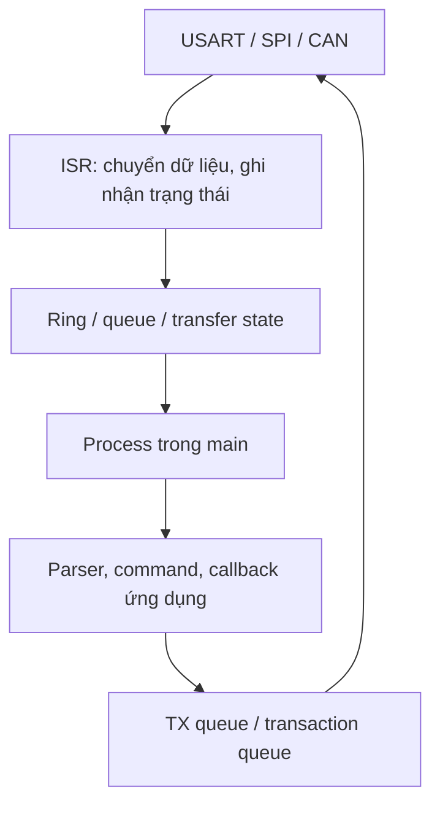
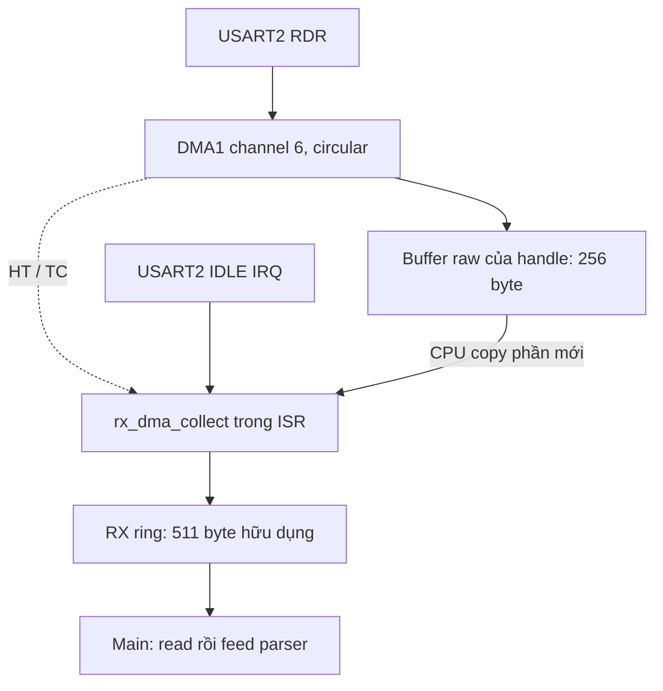

# Học UART, DMA, buffer, SPI và CAN trên STM32F334

Driver tự viết theo form HAL giống GPIO của project: `Config_t`, `Handle_t`,
`PeriClockControl`, `Init/DeInit` và `IRQHandling(handle)`. Backend truy cập
trực tiếp thanh ghi, giữ clock reset HSI 8 MHz và dùng buffer tĩnh. Chú thích trong source dùng
tiếng Việt không dấu; tài liệu này giải thích thứ tự đọc và cách thực hành.

Đọc [kiến trúc giao thức từ application tới hardware](protocol-architecture-guide.md)
để có bức tranh tổng thể. Bài [I2C và FreeRTOS](i2c-freertos-learning.md) mở rộng
project với task, queue, mutex và notification từ ISR.

## 0. Form driver giống GPIO

| GPIO bạn đã viết | UART | SPI | CAN |
|---|---|---|---|
| `GPIO_PinConfig_t` | `UART_Config_t` | `SPI_Config_t` | `CAN_Config_t` |
| `GPIO_Handle_t` | `UART_Handle_t` | `SPI_Handle_t` | `CAN_Handle_t` |
| `pGPIOx` | `pUSARTx` | `pSPIx` | `pCANx` |
| `GPIO_PeriClockControl` | `UART_PeriClockControl` | `SPI_PeriClockControl` | `CAN_PeriClockControl` |
| `GPIO_Init` | `UART_Init` | `SPI_Init` | `CAN_Init` |
| `GPIO_DeInit` | `UART_DeInit` | `SPI_DeInit` | `CAN_DeInit` |
| `GPIO_IRQHandling` | `UART_IRQHandling` | `SPI_IRQHandling` | `CAN_*IRQHandling` |

Handle có ba phần: **con trỏ thanh ghi**, **cấu hình**, **trạng thái chạy**.
GPIO đơn giản nên chỉ cần hai phần đầu. UART/SPI/CAN bất đồng bộ cần thêm
buffer, chỉ số queue, counter và trạng thái để nối tiếp công việc qua nhiều ngắt.
Toàn bộ trạng thái đó thuộc handle; driver chỉ giữ một con trỏ owner để ngăn
hai handle cùng điều khiển một ngoại vi.

Ví dụ khai báo và cấu hình UART giống cách bạn đã dùng GPIO:

```c
/* Global/static: ISR và DMA còn dùng handle sau khi hàm init đã return. */
UART_Handle_t huart2;

bool UART_Setup(void)
{
    /* PA2/PA3 AF7 được cấu hình trước bằng GPIO_Handle_t và GPIO_Init. */
    huart2.pUSARTx = USART2;
    huart2.UART_Config.UART_PCLKHz = 8000000U;
    huart2.UART_Config.UART_BaudRate = 115200U;
    huart2.UART_Config.UART_RxMode = UART_RX_DMA;
    huart2.UART_Config.UART_IRQPriority = 5U;
    return UART_Init(&huart2);
}

void USART2_IRQHandler(void)
{
    UART_IRQHandling(&huart2);
}

/* Trong main sau khi init thành công: */
/* UART_Write(&huart2, (const uint8_t *)"PING\n", 5U); */
/* UART_Process(&huart2); */
```

Đây là mẫu minh họa; demo đã khai báo `huart2` và ISR tương ứng nên không thêm
một bản nữa. Code thực tế nằm trong
[`board_peripherals.c`](../src/app/board_peripherals.c) và
[`interrupts.c`](../src/app/interrupts.c).

Luồng gọi cần nhớ:

```text
Board: GPIO_Init -> gán pXXXx + XXX_Config -> XXX_Init(&handle)
Main:  XXX_Write/Read/Submit/Send(&handle, ...) -> XXX_Process(&handle)
IRQ:   tên vector phần cứng -> XXX_IRQHandling(&handle)
```

`Init` tự bật clock ngoại vi cần thiết; hàm `PeriClockControl` được tách riêng
để giữ form và cho phép kiểm soát clock khi driver đã dừng. `DeInit` dừng driver,
reset ngoại vi, tắt IRQ/clock riêng và nhả owner. UART DeInit hủy dữ liệu đang
chờ; SPI/CAN DeInit từ chối nếu còn TX đang chạy hoặc nằm trong queue. RX/result
CAN chưa đọc sẽ bị bỏ khi DeInit thành công. Không tắt clock trực tiếp giữa
transfer; gọi DeInit và kiểm tra kết quả trước.

Chỉ sửa phần cấu hình khi handle chưa init. Muốn đổi baud/mode: DeInit thành
công, đổi Config rồi Init lại. Không copy một handle đang chạy, không sửa các
field runtime từ ứng dụng. Bản hiện tại triển khai USART2 (8N1), SPI1 master
8-bit và CAN1; API kiểm tra và từ chối instance/chế độ chưa hỗ trợ.

## 1. Chạy ví dụ trước

Build từ thư mục gốc:

```powershell
cmake --preset debug
cmake --build --preset debug --parallel 4
```

Nạp `build/debug/firmware.hex` bằng ST-LINK/STM32CubeProgrammer. Mở terminal
115200 baud, 8 data bits, no parity, 1 stop bit, không flow control. USART2 dùng
PA2 TX / PA3 RX (AF7). Với NUCLEO-F334R8, dùng cổng Virtual COM của ST-LINK nếu
các solder bridge USART2 trên board còn ở cấu hình mặc định; nếu board đã thay
đổi đường nối, kiểm tra schematic hoặc dùng USB-UART mức 3.3 V và chung GND.
Không nối hai nguồn TX cùng lái PA3. Terminal cần gửi LF hoặc CRLF khi Enter;
bật local echo nếu muốn nhìn ký tự mình gõ.

LED PA5 nháy mỗi 500 ms trong khi main vẫn phục vụ giao tiếp. Thử lần lượt:

```text
PING
LED ON
LED OFF
LED TOGGLE
LED AUTO
STATS
SPI TEST
CAN TEST
CAN STATS
HELP
```

`PING` trả `PONG`. `CAN TEST` gửi ID `0x123`, bốn byte `11 22 33 44` trong silent
loopback. Bạn sẽ thấy `CAN RX id=291 data: 11 22 33 44` và `CAN TX OK` (thứ tự
hai dòng tùy tiến độ ngắt). Số 291 là cách in thập phân của `0x123`.

`SPI TEST` hoạt động ngay nhưng dữ liệu MISO chưa nối không xác định. Để thử
loopback SPI, nối **PB5 MOSI với PB4 MISO** khi chưa có slave khác trên bus.
Kết quả mong đợi: `SPI RX: 12 34 56 A5`. PB3 là SCK, PB6 là CS phần mềm;
ví dụ dùng mode 0, PCLK2/16 = 500 kHz. PB3/PB4 chia sẻ chức năng debug JTAG/SWO:
dùng SWD trên PA13/PA14, không bật trace SWO trên PB3 khi thử SPI.

CAN mặc định **silent loopback nội bộ**, không cần transceiver hay node thứ hai.
Muốn thử bus thật: đổi `DEMO_CAN_LOOPBACK` thành 0 trong
[`demo_config.h`](../src/app/demo_config.h), dùng transceiver tương thích mức
logic 3.3 V trên PA11 RX / PA12 TX (AF9), chung GND và điện trở kết thúc đúng
ở hai đầu bus. Cần node thứ hai cùng bitrate để ACK. Bitrate mặc định 125 kbit/s;
HSI chỉ là cấu hình học ban đầu, cần tính sai số clock/bit timing và kiểm chứng
trên bus thật trước khi dùng trong hệ thống.

## 2. Thứ tự đọc source

| Thứ tự | File | Điều cần hiểu |
|---|---|---|
| 1 | [`src/test/main.c`](../src/test/main.c) | Init timebase, init ứng dụng, vòng lặp không delay |
| 2 | [`board_peripherals.c`](../src/app/board_peripherals.c) | GPIO_Handle, cấu hình các handle ngoại vi |
| 3 | [`interrupts.c`](../src/app/interrupts.c) | Vector ngắt chuyển handle cho driver |
| 4 | [`communication_demo.c`](../src/app/communication_demo.c) | Gọi service, nhận command và callback |
| 5 | [`line_parser.c`](../src/services/line_parser.c) | Ghép nhiều lần nhận thành một dòng lệnh |
| 6 | [`STM32F334_UART.c`](../src/drivers/STM32F334_UART.c) | RXNE, DMA RX, RX/TX ring, IRQHandling |
| 7 | [`STM32F334_SPI.c`](../src/drivers/STM32F334_SPI.c) | Queue transaction và state machine |
| 8 | [`STM32F334_CAN.c`](../src/drivers/STM32F334_CAN.c) | Queue frame, mailbox, TX result |
| 9 | [`STM32F334_CORE.c`](../src/drivers/STM32F334_CORE.c) | NVIC, critical section và SysTick |

Chạy debugger với breakpoint trong `command()` hoặc callback SPI sẽ giúp thấy
callback chạy ở main. Dừng CPU quá lâu trong khi ngoại vi còn nhận có thể làm
DMA/FIFO tràn; đây không phải cách đo độ tin cậy của luồng RX liên tục.



## 3. Bài đầu: UART ngắt từng byte

Đổi `DEMO_UART_USE_DMA` thành 0 và build lại. Luồng nhận:

```text
PA3 -> USART RDR -> RXNE IRQ -> rx_push -> RX ring -> UART_Read(&huart2, ...)
    -> LineParser_Feed -> command
```

`head` là ô sẽ ghi tiếp; `tail` là ô sẽ đọc tiếp. Sau khi ghi dữ liệu mới cập
nhật head. RX ring có 512 ô nhưng chỉ dùng 511 ô để phân biệt rỗng và đầy:

```text
Rỗng: head == tail
Đầy:  (head + 1) % RX_SIZE == tail
```

ISR ghi head; main đọc và cập nhật tail. Bài này dùng critical section ngắn để
bảo vệ trạng thái dùng chung, dễ kiểm tra hơn một ring lock-free. `IRQ_Save()`
lưu PRIMASK trước khi tắt ngắt, `IRQ_Restore()` khôi phục đúng trạng thái cũ.
Không dùng cặp disable/enable vô điều kiện vì có thể mở ngắt sớm trong hàm lồng.

Main lấy tối đa 64 byte mỗi vòng, rồi mới parser ngoài critical section. Như
vậy xử lý lệnh không giữ ngắt bị khóa. `volatile` không thay thế critical section.

Thử gửi `LED ` rồi sau một khoảng nghỉ mới gửi `ON\n`: parser vẫn phải ghép
thành một lệnh. Ngược lại, `PING\nLED ON\n` trong một lần nhận là hai lệnh.

## 4. Bài thứ hai: UART DMA circular

Đổi `DEMO_UART_USE_DMA` về 1. USART2 RX dùng DMA1 channel 6; TX dùng channel 7.
DMA chuyển byte từ RDR vào buffer raw 256 byte của handle mà CPU không phải đọc từng byte.



- **HT:** DMA đến nửa buffer. **TC:** DMA hết buffer và nạp lại bộ đếm.
- **IDLE:** USART thấy khoảng nghỉ. Dùng để lấy đoạn cuối chưa đến HT/TC.
- Không chỉ dựa vào IDLE: stream liên tục có thể không nghỉ.
- Trong chế độ DMA, RXNE ISR không đọc RDR cạnh tranh với DMA.

`CNDTR` cho biết còn bao nhiêu phần tử của vòng hiện tại. Vị trí ghi trong vòng
được tính từ `RAW_SIZE - CNDTR`, nhưng vị trí modulo không phân biệt được không
có byte mới với vừa đi hết một vòng. Driver kết hợp TC để đếm tiến độ qua vòng,
đọc snapshot TC/CNDTR ổn định và ghi nhớ tổng byte đã copy. Nếu đoạn mới vượt
khả năng buffer, driver báo mất tính liên tục thay vì giả vờ dữ liệu còn đúng.

UART và DMA ISR dùng chung collector dưới critical section; một IDLE xuất hiện
sát HT không được copy lại dữ liệu đã lấy. Collector chỉ xóa những cờ đã xử lý
bằng ghi trực tiếp IFCR, không dùng `|=` lên thanh ghi W1C.

Ở 115200 8N1, một byte cần 10 bit, nửa buffer 128 byte mất khoảng **11,1 ms**.
Phải phục vụ ngắt và copy xong vùng cũ trước khi DMA quay lại. Không khóa ngắt
lâu hoặc coi DMA buffer là vùng lưu vô hạn. Nhiều vòng bị ghi đè với cờ ngắt đã
gộp không thể tái dựng đầy đủ bằng phần mềm. Buffer DMA đặt trong SRAM thường
ở `0x20000000`; CCM không cho DMA truy cập.

## 5. Buffer đầy và mất byte: không thực thi lệnh hỏng

RX ring đầy thì bỏ byte mới, giữ byte chưa đọc và tăng `rx_dropped` / `rx_epoch`.
Lỗi USART hoặc DMA cũng đổi epoch. Main lấy epoch và byte trong cùng critical
section. Khi epoch đổi, main xóa phần chờ và yêu cầu parser bỏ tới LF tiếp theo.

Ví dụ, nếu mất byte giữa `LED O` và `N`, ứng dụng không được ghép tùy tiện rồi
thực thi `LED ON`. Sau lỗi, gửi một Enter để đồng bộ lại rồi gửi `PING`.
Parser cũng bỏ toàn bộ dòng quá dài hoặc chứa NUL/control byte; không thực thi
prefix hợp lệ của một dòng hỏng. Buffer dòng dài 64 byte gồm ký tự kết thúc
NUL: tối đa 63 byte trước LF; CR trong CRLF cũng chiếm một ô trước khi được bỏ.

`UART_Write(&huart2, ...)` copy dữ liệu vào TX ring và trả số byte nhận được. Caller có thể
tái sử dụng input ngay, nhưng phải quyết định retry hay bỏ khi queue đầy. Demo
không chờ chặn; `tx_dropped` đếm số byte bị từ chối (kể cả mỗi lần thử lại) và
phần bị bỏ khi DMA TX lỗi. Vì vậy output terminal có thể thiếu nếu cố gửi quá tải.

TX DMA chỉ lấy một đoạn liên tục của ring, giữ tail đến TC rồi mới giải phóng
đoạn đó. Khi ring wrap, phần còn lại được gửi bằng lượt DMA tiếp theo. DMA TC
chỉ báo đã chuyển byte cuối vào TDR; `UART_TxIdle(&huart2)` còn kiểm tra USART TC để
biết phần cứng đã phát hết trên dây.

## 6. SPI: transaction là đơn vị công việc

SPI trong ví dụ dùng **ngắt, không DMA**. `SPI_Config_t` chứa master/data size,
CPOL/CPHA, divisor và priority. Mỗi transaction chứa CS, con trỏ TX/RX, chiều dài,
timeout và callback. Queue trong handle chứa bốn descriptor chờ,
cộng một transaction active. Có thể thêm DMA backend sau khi hiểu state machine.

```text
Submit -> QUEUED -> TRANSFER -> WAIT_END -> callback trong main
                         \-> ERROR/timeout -> reset ngoại vi -> callback lỗi
```

- Mỗi lúc chỉ một transaction sở hữu bus. CS chỉ đổi ở lúc bắt đầu/kết thúc.
- TX và RX diễn ra cùng lúc; `tx=NULL` gửi `0xFF` để tạo clock, `rx=NULL` vẫn đọc
  DR rồi bỏ dữ liệu để tránh overflow.
- Để dễ học, ISR chỉ cho một byte đang chờ RX; nhận byte đó rồi mới gửi byte sau.
  Cách này có khoảng trống giữa byte, throughput thấp hơn dùng FIFO/DMA đầy đủ.
- DR phải truy cập 8 bit khi frame 8 bit; truy cập rộng có thể đóng gói thêm byte.
- Nhận đủ byte chuyển sang WAIT_END; main kiểm tra FIFO TX rỗng và BSY=0 trước
  khi nhả CS. Không spin-wait hay gọi user callback trong ISR.
- Timeout tính từ lúc transaction bắt đầu, không tính thời gian chờ queue.
- Descriptor được copy nhưng buffer không được copy. Buffer và context phải còn
  sống, không bị caller sửa tới callback; ví dụ dùng các mảng static.

Trong callback SPI, thử đặt breakpoint rồi xem `spi_rx`. Đổi mode/divisor trong
`hspi1.SPI_Config` trước Init để phù hợp sensor. Muốn đổi khi đã chạy, chờ SPI
rảnh, DeInit rồi cấu hình và Init lại. Board cấu hình mọi CS output/high trước
`SPI_Submit(&hspi1, &transaction)`; driver không tự gán chân PB6.

## 7. CAN: nhận nguyên frame, không cần parser dòng

CAN khác UART: controller đã biết ranh giới frame. RX ISR copy nguyên frame
từ FIFO rồi mới release FIFO. Main lấy frame từ queue và dispatch theo ID.
Driver hỗ trợ standard ID, extended ID, data/RTR; đây là classical CAN tối đa
8 byte payload, không phải CAN FD. Filter demo nhận mọi ID vào FIFO0.

TX queue chứa tám frame chờ, hardware có ba mailbox. `CAN_Send(&hcan1, ...)` trả true
chỉ có nghĩa đã nhận yêu cầu, không phải đã phát thành công. Main phải lấy
`CAN_GetTxResult(&hcan1, ...)` để biết OK/error/timeout/bus-off của frame nào.

Quá 100 ms, Process yêu cầu abort; mailbox chỉ được tái sử dụng khi phần cứng
báo RQCP hoàn tất, không giải phóng ngay khi vừa ghi ABRQ. ABOM cho hardware
phục hồi bus-off; frame còn trong software queue được giữ, frame đang chạy
được abort và báo kết quả. Queue kết quả cũng phải được đọc đều đặn.

Bit timing tính từ **PCLK1**, không tự dùng clock CPU:

```text
bitrate = PCLK1 / (BRP * (1 + BS1 + BS2))
8 MHz / (4 * (1 + 13 + 2)) = 125 kbit/s
```

Thử thay CAN ID/payload rồi quan sát loopback. Sau đó thử extended/RTR trước
khi chuyển sang bus thật. `CAN STATS` giúp thấy RX drop, TX fail, timeout, bus-off.

## 8. Nền ngắt đã sửa

Code GPIO cũ dùng địa chỉ ISER để ghi priority. Driver core dùng đúng IPR từ
`0xE000E400`, mỗi IRQ một byte; STM32F334 có bốn bit priority. ISER/ICER và
EXTI PR dùng ghi mask trực tiếp. GPIO EXTI được đặt input và mở IMR.
API GPIO cũ vẫn dùng được nhưng chuyển việc NVIC sang core dùng chung.

SysTick chỉ tăng bộ đếm millisecond; mọi thao tác LED, command và callback
đều ở main. Dùng phép trừ unsigned để timeout vẫn đúng khi tick quay vòng.

`runtime.c` cung cấp memcpy/memset tối thiểu vì compiler có thể tự gọi chúng
khi copy hoặc khởi tạo struct, đặc biệt ở Release. Không liên kết libc, không
có malloc/printf. Không sửa `src/systerm` thành tên khác trong bài này để giữ
đường dẫn startup hiện có của project.

## 9. Kiểm thử trên PC và giới hạn kiểm chứng

Tests dùng compiler native của PC, **không** dùng ARM preset:

```powershell
cmake -S tests -B build/host-tests -G "MinGW Makefiles" -DCMAKE_C_COMPILER=gcc
cmake --build build/host-tests --parallel 4
ctest --test-dir build/host-tests --output-on-failure
```

Parser được test với nhận phân mảnh, nhiều dòng, CRLF, dòng quá dài, mất byte và
NUL. Tests ngoại vi dùng register mock để kiểm tra luồng buffer/state machine,
không mô phỏng timing điện, clock, DMA bus arbitration hay hành vi đầy đủ của MCU.
Build ARM kiểm tra liên kết, dung lượng và vector ngắt. Firmware chưa được chạy
trên board trong phiên làm việc này; cần nạp và kiểm tra thực tế theo các bước trên.

## Tài liệu gốc để đọc song song

- [ST RM0364](https://www.st.com/resource/en/reference_manual/rm0364-stm32f334xx-advanced-armbased-32bit-mcus-stmicroelectronics.pdf): DMA, USART, SPI, bxCAN và memory map.
- [ST DS9994 / STM32F334R8](https://www.st.com/resource/en/datasheet/stm32f334r8.pdf): alternate functions và đặc tính clock.
- [ST STM32F334x8 register definitions](https://github.com/STMicroelectronics/cmsis-device-f3/blob/master/Include/stm32f334x8.h): đối chiếu bit/offset/IRQ.
- [ST UM1724](https://www.st.com/resource/en/user_manual/um1724-stm32-nucleo64-boards-mb1136-stmicroelectronics.pdf): schematic và đường nối ST-LINK Virtual COM của Nucleo.
