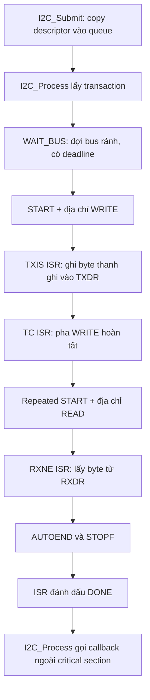
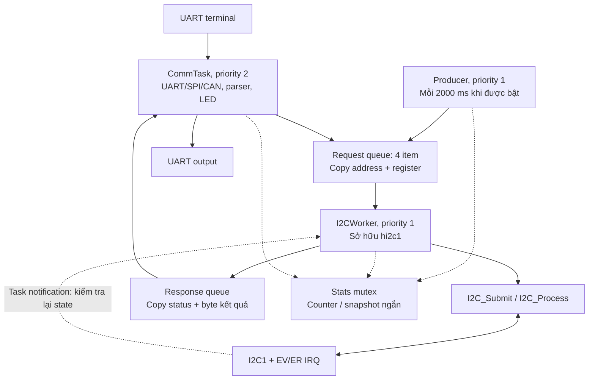

# Học I2C và FreeRTOS trên STM32F334

Tài liệu này nối tiếp [bài UART/SPI/CAN](communication-learning.md). Đọc thêm [kiến trúc application → driver → hardware](protocol-architecture-guide.md) để liên hệ các lớp. Cùng một bộ driver dạng `Config_t` + `Handle_t` được dùng trong hai bản firmware: vòng lặp bare-metal và FreeRTOS. Driver tiếp tục đọc/ghi thanh ghi trực tiếp.

## 1. Chạy bản nào trước?

Từ thư mục gốc dự án:

```powershell
# Bare-metal: học transaction và ISR trước.
cmake --preset debug
cmake --build --preset debug --parallel 4

# FreeRTOS: học task, queue, mutex và ISR -> task.
cmake --preset rtos-debug
cmake --build --preset rtos-debug --parallel 4
```

Hai preset tương ứng `FIRMWARE_USE_FREERTOS=OFF` và `ON`, dùng thư mục build riêng. Các bản Release là `release` và `rtos-release`. Nạp đúng `build/debug/firmware.hex` hoặc `build/rtos-debug/firmware.hex`; các bản BIN bắt đầu tại `0x08000000`.

UART terminal vẫn là USART2, PA2/PA3, 115200 baud, 8N1. Gửi mỗi lệnh bằng một dòng kết thúc LF hoặc CRLF.

| Lệnh | Bare-metal | FreeRTOS |
|---|---|---|
| `HELP` | Liệt kê lệnh | Liệt kê lệnh |
| `I2C READ` | Gửi một transaction đọc ví dụ | Đưa yêu cầu vào queue của I2CWorker |
| `I2C STATS` | Xem kết quả/thống kê I2C | Xem thông tin I2C mà ứng dụng cung cấp |
| `RTOS START` | Không có producer RTOS | Cho phép Producer tạo yêu cầu mỗi 2 giây |
| `RTOS STOP` | Không có producer RTOS | Dừng tạo yêu cầu định kỳ mới |
| `RTOS STATS` | Không có kernel RTOS | Xem bộ đếm, queue và stack high-water mark |

Producer **tắt khi khởi động**. `RTOS STOP` chỉ dừng phát sinh yêu cầu mới; các yêu cầu đã vào queue hoặc đang chạy vẫn được xử lý.

## 2. Nối phần cứng I2C

| Tín hiệu | STM32F334 | Cấu hình GPIO |
|---|---|---|
| SCL | PB8 | AF4, open-drain |
| SDA | PB9 | AF4, open-drain |
| GND | GND | Chung mass với thiết bị |

SCL và SDA cần điện trở kéo lên **bên ngoài** tới nguồn logic phù hợp; ví dụ thường dùng 4.7 kΩ cho bus 3.3 V ngắn, rồi kiểm tra theo điện dung bus và datasheet thiết bị. Pull-up nội không thay thế việc chọn pull-up cho bus thực tế. Kiểm tra module đã có pull-up và điện áp kéo lên trước khi nối.

Địa chỉ và thanh ghi ví dụ nằm trong `demo_config.h`: `DEMO_I2C_ADDRESS = 0x50`, `DEMO_I2C_REGISTER = 0x00`. Đây là cấu hình mẫu, không giả định board đã gắn EEPROM hay cảm biến. Thay theo datasheet thiết bị của bạn. Khi có pull-up đúng nhưng không có thiết bị ở địa chỉ đó, kết quả có thể là NACK; bus chưa kéo lên hoặc bị giữ thấp có thể trả timeout.

Driver dùng địa chỉ 7 bit **chưa dịch trái**: truyền `0x50`, không truyền `0xA0`. Bài này chấp nhận dải `0x08..0x77`, tránh các địa chỉ dành riêng; chỉ hỗ trợ master 7 bit.

Clock I2C1 trong bài là HSI 8 MHz, `I2C1SW=0`, analog filter bật, digital filter bằng 0. `I2C_TIMING_100KHZ_HSI8 = 0x10420F13` là cấu hình danh định khoảng 100 kHz; tốc độ thực tế còn phụ thuộc thời gian lên/xuống tín hiệu. Driver không tự đổi clock mux. Đối chiếu timing với [ST RM0364, phần I2C và bảng TIMINGR](https://www.st.com/resource/en/reference_manual/dm00093941-stm32f334xx-advanced-armbased-32bit-mcus-stmicroelectronics.pdf).

## 3. Đọc driver I2C theo thứ tự nào?

1. [STM32F334_I2C.h](../src/drivers/STM32F334_I2C.h): cấu hình, handle, transaction và kết quả.
2. [board_peripherals.c](../src/app/board_peripherals.c): `Board_I2CInit` chọn PB8/PB9, AF4 và open-drain.
3. [STM32F334_I2C.c](../src/drivers/STM32F334_I2C.c): `I2C_Init`, `I2C_Submit`, `I2C_Process`, rồi các hàm IRQ.
4. [interrupts.c](../src/app/interrupts.c): tên ISR đúng vector, chuyển handle tới driver.
5. [communication_demo.c](../src/app/communication_demo.c): lệnh terminal và callback trong ngữ cảnh ứng dụng.

Form khởi tạo giống GPIO:

```c
/* Trich y tuong Board_I2CInit; GPIO da duoc cau hinh rieng. */
hi2c1.pI2Cx = I2C1;
hi2c1.I2C_Config.I2C_KernelHz = 8000000U;
hi2c1.I2C_Config.I2C_Timing = I2C_TIMING_100KHZ_HSI8;
hi2c1.I2C_Config.I2C_IRQPriority = 6U;
bool ready = I2C_Init(&hi2c1);
```

`I2C_Init` bật clock cần thiết và thiết lập ngoại vi/NVIC. GPIO thuộc phần board. Một peripheral chỉ có một handle đang sở hữu; không gọi `Init` lần nữa để ghi đè một driver đang chạy. `I2C_DeInit` chỉ thành công khi idle, queue rỗng và đang ở ngoài callback.

## 4. Một lần đọc thanh ghi đi qua những bước nào?

Ví dụ đọc một byte từ thanh ghi có địa chỉ một byte:

```text
START -> address + WRITE -> register -> repeated START
      -> address + READ -> data -> master NACK -> STOP
```

Pha WRITE đặt con trỏ thanh ghi trong thiết bị, pha READ lấy dữ liệu. Đây là **một transaction**, không chèn STOP giữa hai pha.



`I2C_Submit` trả `true` nghĩa là descriptor được nhận vào queue. Chỉ callback `I2C_OK` mới báo transaction hoàn tất thành công. Mỗi pha hiện giới hạn 255 byte; ít nhất một pha phải có dữ liệu. Chưa có address-only probe, địa chỉ 10 bit hay RELOAD cho pha dài hơn 255 byte.

ISR xử lý byte và trạng thái, không phân tích command, in terminal hay gọi callback người dùng. `I2C_Process` thực hiện callback và kiểm tra timeout. NACK, bus error, arbitration lost, overrun và timeout có kết quả riêng. Driver không tự retry; ứng dụng quyết định có gửi yêu cầu mới hay không.

Khi mất arbitration, controller không còn sở hữu bus nên không ép STOP lên master đang thắng. Khi timeout, driver có thể reset controller của mình; reset này không tự phát xung SCL để giải cứu slave giữ SDA thấp.

## 5. Hai lớp queue có trách nhiệm khác nhau

**Queue của driver** lưu `I2C_Transaction`, trong đó `tx`, `rx`, `context` là con trỏ. Chỉ descriptor được copy; dữ liệu mà con trỏ trỏ tới phải còn sống và không bị sửa tới callback.

**Queue của FreeRTOS** chuyển yêu cầu từ task khác tới I2CWorker. Request chứa giá trị địa chỉ/thanh ghi; response chứa byte kết quả và trạng thái. Các giá trị nằm trong item queue được copy. Nếu item chứa con trỏ thì chỉ con trỏ được copy, không phải dữ liệu phía sau nó. [FreeRTOS queue API](https://github.com/FreeRTOS/FreeRTOS-Kernel/blob/V11.3.3/include/queue.h)

Worker nhận request vào biến đang hoạt động của mình, giữ byte thanh ghi TX, byte RX và callback context đến khi callback hoàn tất, rồi mới tái sử dụng cho request tiếp theo. Một biến trên stack của task có thể dùng cho transfer async **nếu task vẫn giữ nguyên vùng nhớ đó trong suốt transfer**; biến local của hàm đã return thì không đáp ứng điều kiện này.

## 6. Từ vòng lặp main sang ba task



| Task | Sở hữu | Nhường CPU |
|---|---|---|
| CommTask | UART/SPI/CAN, GPIO/TIM/ADC/PWM, line parser, terminal, LED | `vTaskDelay(1)` mỗi vòng |
| I2CWorker | `hi2c1`, transfer đang chạy, callback I2C | Đợi request; khi active đợi notification tối đa 1 tick |
| Producer | Lịch tạo request định kỳ | `xTaskDelayUntil`, chu kỳ 2000 ms |
| Idle | Công việc nền của kernel | Kernel tự quản lý |

`CommunicationDemo_Init/Process` chạy trong CommTask ở bản RTOS. Callback SPI vì thế chạy trong CommTask. Callback I2C chạy trong I2CWorker, ghi kết quả và đánh dấu `done`; Worker sau đó copy response vào queue, **không gọi UART trực tiếp**. CommTask nhận kết quả và in terminal.

Task mới muốn dùng các peripheral này cần gửi yêu cầu tới task đang sở hữu. Các critical section ngắn trong driver bảo vệ state với ISR; chúng không biến toàn bộ API thành driver nhiều task dùng đồng thời.

Đọc phần chia task và đối tượng kernel tại [rtos_demo.c](../src/rtos/rtos_demo.c). API ứng dụng RTOS trong [rtos_demo.h](../src/rtos/rtos_demo.h):

| API | Vai trò |
|---|---|
| `RTOS_Start()` | Tạo đối tượng static, tạo task, chạy scheduler |
| `RTOS_QueueI2CRead(address, reg)` | Gửi request theo giá trị; `false` khi không nhận được |
| `RTOS_TakeI2CResult(&response)` | CommTask lấy response đã copy |
| `RTOS_SetProducerEnabled(enabled)` | Bật/tắt việc phát sinh request định kỳ |
| `RTOS_GetStats(&stats)` | Lấy snapshot thống kê qua mutex |
| `RTOS_I2CNotifyFromISR()` | Cầu nối ISR I2C tới I2CWorker |

## 7. Queue, mutex và task notification dùng lúc nào?

**Queue mang dữ liệu.** Producer và CommTask gửi yêu cầu đọc; Worker xử lý lần lượt. Queue đầy phải có kết quả từ chối/bộ đếm; không được ghi đè request chưa xử lý. Một response lỗi vẫn là một kết quả có giá trị để ứng dụng quan sát.

**Mutex bảo vệ tài nguyên dùng chung giữa task.** Stats mutex bảo vệ bộ đếm và snapshot nhất quán giữa Producer, I2CWorker và CommTask. Giữ mutex chỉ để tăng counter hoặc copy snapshot; nhả nó trước khi chờ queue, gọi driver hay in UART. I2CWorker là task duy nhất dùng bus API, nên không cần thêm mutex cho chính bus.

Mutex FreeRTOS có priority inheritance: task đang giữ mutex có thể được nâng priority khi một task ưu tiên cao hơn chờ mutex đó. Mutex không được take/give trong ISR. [FreeRTOS semaphore/mutex API](https://github.com/FreeRTOS/FreeRTOS-Kernel/blob/V11.3.3/include/semphr.h)

**Task notification đánh thức một task.** ISR I2C gọi driver handler trước, rồi cầu nối RTOS dùng API `...FromISR` và `portYIELD_FROM_ISR` khi cần. Worker gọi `ulTaskNotifyTake(pdTRUE, ...)` để chờ. Notification không mang byte RX và không đồng nghĩa transfer đã thành công: nó yêu cầu Worker kiểm tra state qua `I2C_Process`. Timeout chờ tối đa 1 tick khi active giúp driver vẫn phát hiện transaction bị kẹt ngay cả khi không còn IRQ.

Trong bài này notification đảm nhiệm việc báo thức mà một binary semaphore cũng có thể thực hiện. Một lần thức dậy có thể đại diện nhiều IRQ; dữ liệu/trạng thái thật vẫn nằm trong driver. Không dùng số lần thức dậy làm số byte hay số transaction. [FreeRTOS task notification API](https://github.com/FreeRTOS/FreeRTOS-Kernel/blob/V11.3.3/include/task.h)

## 8. SysTick, priority và critical section

CPU vẫn dùng HSI reset 8 MHz. `main` gọi `Timebase_Init` trước khi khởi động RTOS. `SysTick_Handler` tăng timebase mili giây; khi scheduler đã bắt đầu, kể cả lúc scheduler đang suspended, nó gọi `xPortSysTickHandler` để kernel nhận tick. Nếu SysTick xảy ra trước scheduler, wrapper chỉ cập nhật timebase ứng dụng. Kernel có thể mask IRQ trong giai đoạn tạo đối tượng trước scheduler, nên không dùng giai đoạn này để chờ timeout ngoại vi. Không gọi lại `Timebase_Init` khi scheduler đang chạy để thay cấu hình SysTick.

Bản này dùng tick 1000 Hz, không tickless. `SVC_Handler` và `PendSV_Handler` trỏ trực tiếp vào port; SysTick dùng wrapper riêng nên không macro-map lần nữa. Đọc [CORE.c](../src/drivers/STM32F334_CORE.c), [FreeRTOSConfig.h](../src/rtos/FreeRTOSConfig.h) và [port ARM_CM3 chính thức](https://github.com/FreeRTOS/FreeRTOS-Kernel/blob/V11.3.3/portable/GCC/ARM_CM3/port.c).

Hai loại priority có chiều ngược nhau:

| Loại | Giá trị nhỏ | Ví dụ |
|---|---|---|
| NVIC IRQ, 0..15 | Ưu tiên cao hơn | IRQ 3 có thể ngắt IRQ 6 |
| FreeRTOS task, 0..3 trong cấu hình này | Ưu tiên thấp hơn | CommTask 2 chạy trước Worker 1 khi cả hai Ready |

`configMAX_SYSCALL_INTERRUPT_PRIORITY` bằng `5 << 4 = 0x50`. IRQ gọi FreeRTOS `...FromISR` phải có priority logic 5..15; I2C dùng 6. IRQ ưu tiên 0..4 vẫn có thể chạy, nhưng không được gọi kernel API. API task thông thường và mutex không dùng trong ISR. Cầu nối notification có guard để bỏ qua lúc kernel/Worker chưa sẵn sàng.

`IRQ_Save` đặt PRIMASK, chặn cả SysTick/PendSV và các IRQ dữ liệu. Không gọi hàm có thể block/yield, không đợi mutex/queue và không busy-wait dài trong vùng này. UART DMA vẫn cần được phục vụ kịp thời như ở bản bare-metal; RTOS không sửa được dữ liệu đã bị DMA ghi đè.

## 9. Bộ nhớ và cách tự kiểm tra khi học

Kernel được ghim ở **FreeRTOS V11.3.3**, commit `89592801dd8b73329a7583719b7e3567b50910e5`, trong `third_party/FreeRTOS-Kernel`. Mã nguồn upstream giữ nguyên; cấu hình và hooks của ứng dụng nằm riêng trong `src/rtos`.

Task, queue và mutex đều dùng static allocation: không build `heap_1.c..heap_5.c`, không cần heap FreeRTOS. Mỗi task có TCB và stack riêng do ứng dụng cấp phát; Idle cũng có TCB/stack riêng. [FreeRTOS static task creation](https://github.com/FreeRTOS/FreeRTOS-Kernel/blob/V11.3.3/include/task.h)

| Stack | Số word 32 bit | Byte |
|---|---:|---:|
| CommTask | 384 | 1536 |
| I2CWorker | 256 | 1024 |
| Producer | 192 | 768 |
| Idle | 128 | 512 |
| Tổng stack task | 960 | 3840 |

Đây chưa phải toàn bộ RAM: còn TCB, queue storage, handle/buffer driver, biến ứng dụng và MSP cho startup/ISR. Linker dùng 12 KB SRAM thông thường và chừa ít nhất 1 KB cho MSP. Port `ARM_CM3` được dùng cho đường chạy Cortex-M4 không lưu FPU context; toàn bộ bản build giữ `-mfloat-abi=soft`, không dùng lệnh FPU trong task/ISR.

`RTOS STATS` hiển thị stack high-water mark theo **word còn trống**, không phải byte. Giá trị nhỏ cần được theo dõi sau những đường chạy tốn stack như in stats, lỗi bus và callback. Việc link vừa RAM hay kiểm tra overflow mode 2 không chứng minh mọi đường chạy an toàn; MSP của ISR cũng cần được quan sát khi kiểm thử trên board.

Khi assert/stack-overflow/startup failure xảy ra, hook bật LED PA5 và lưu lỗi đầu tiên trong `g_rtos_fault_code`, `g_rtos_fault_file`, `g_rtos_fault_line` cùng thông tin task khi có. Xem các biến bằng debugger; fault handler không cố in UART hay lấy mutex.

## 10. Bài thực hành ngắn

1. Build bare-metal, mở terminal, gửi `PING` rồi `I2C READ`. Không gắn thiết bị thì quan sát NACK và counter lỗi.
2. Gắn một thiết bị đúng điện áp/pull-up, chỉnh address/register theo datasheet, đọc lại và đối chiếu byte trả về.
3. Build FreeRTOS, gửi `I2C READ`. Theo breakpoint: CommTask gửi request -> Worker submit -> IRQ -> Worker callback -> CommTask in response.
4. Gửi `RTOS START`, quan sát request mỗi 2 giây; thử `PING`/LED/SPI/CAN đồng thời rồi xem `RTOS STATS`.
5. Gửi `RTOS STOP`, xác nhận không tạo request định kỳ mới và UART vẫn phản hồi.
6. Theo debugger qua đoạn lấy/nhả stats mutex. Phân biệt khóa tài nguyên với việc Worker đang chờ notification.

Các kiểm tra native với thanh ghi giả lập kiểm tra state machine, queue, callback và lỗi phần mềm. Build ARM kiểm tra tích hợp/link. Chúng không mô phỏng toàn bộ timing điện của I2C hay chứng minh scheduler chạy đúng trên silicon; phần cứng thực tế cần được nạp và kiểm tra riêng.
