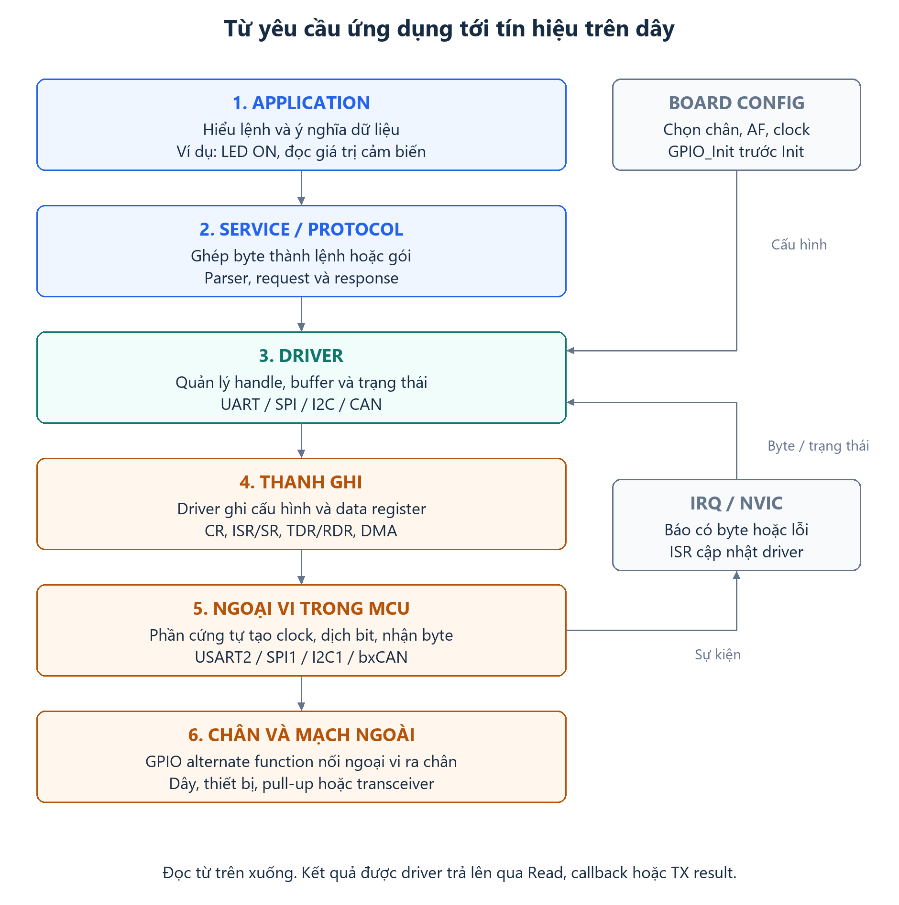
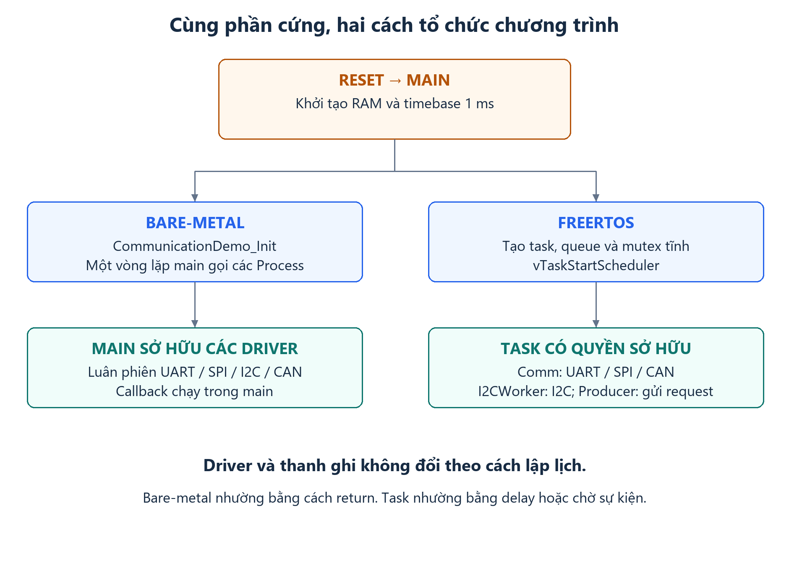
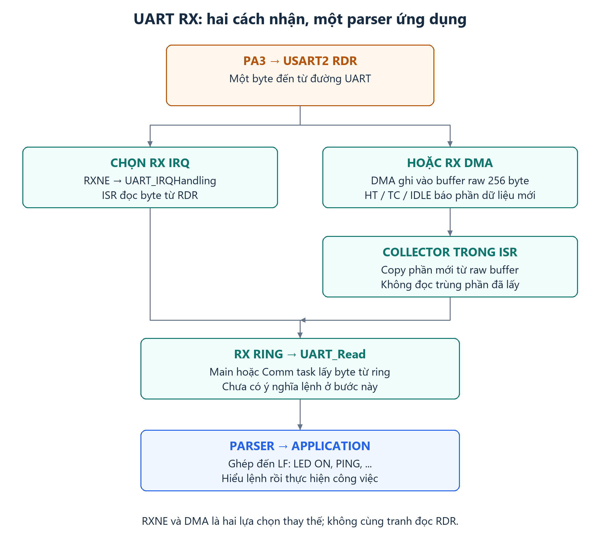
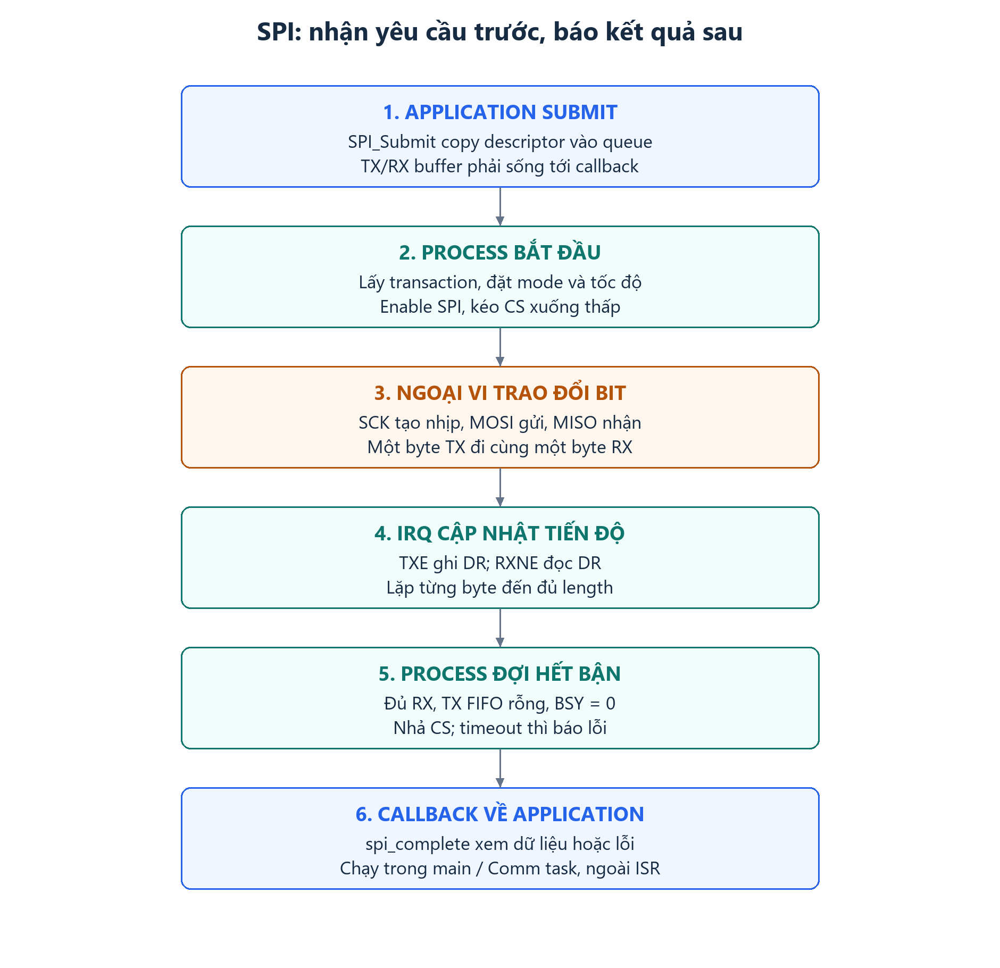
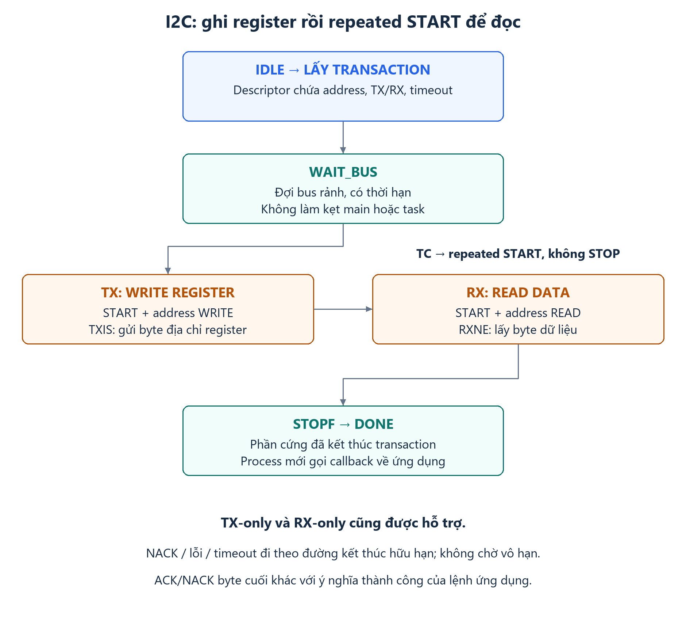
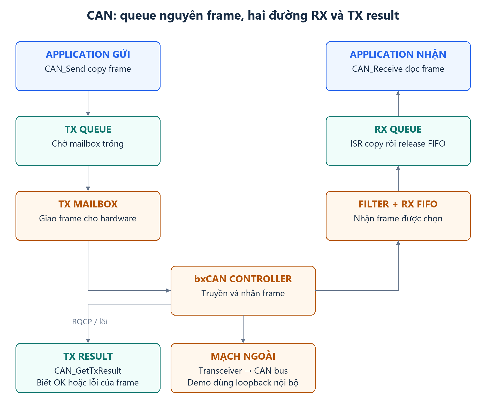
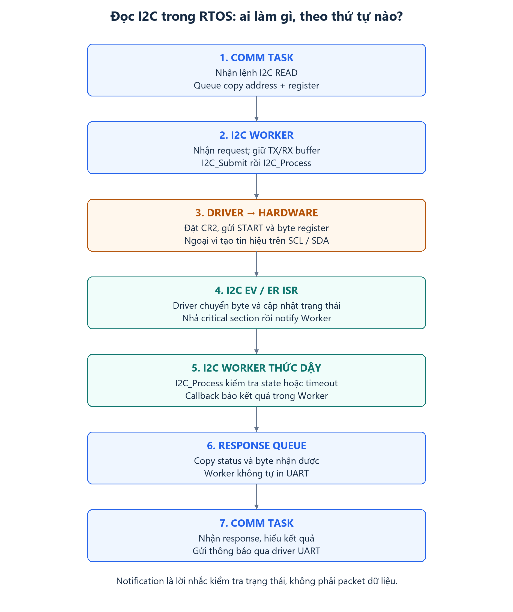
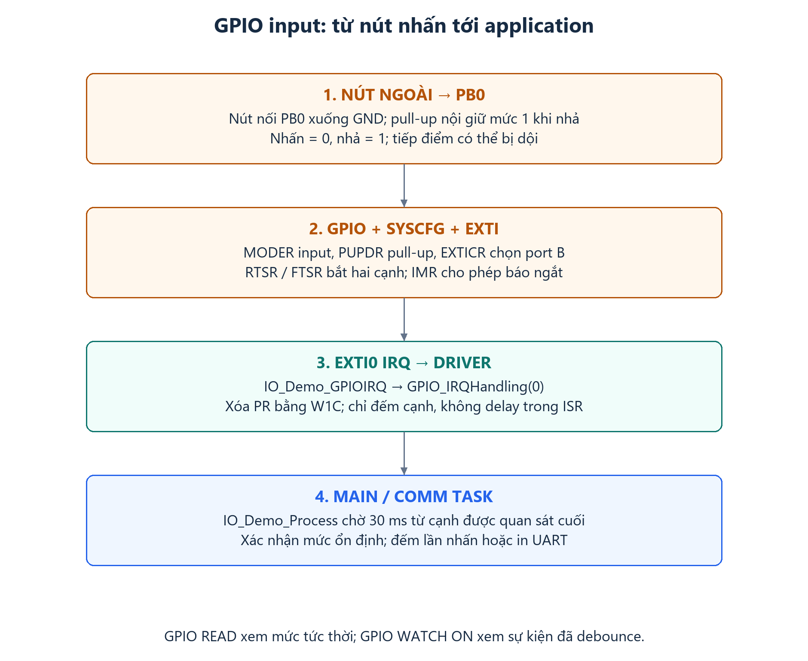
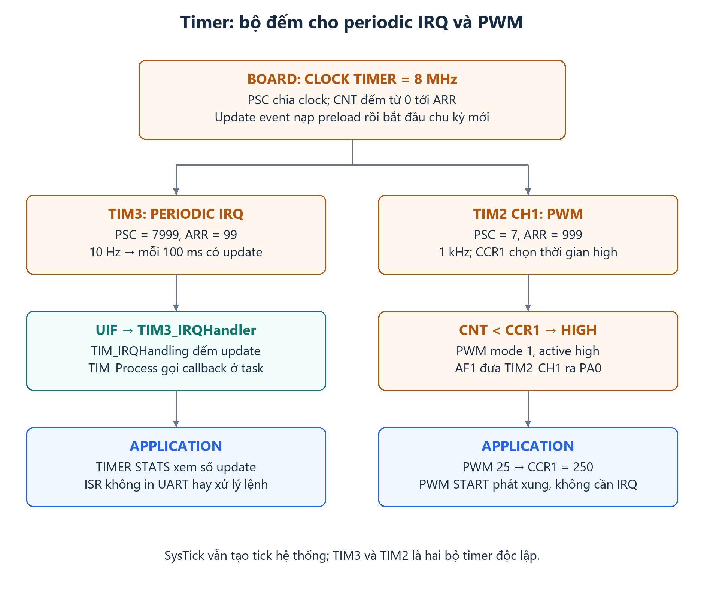
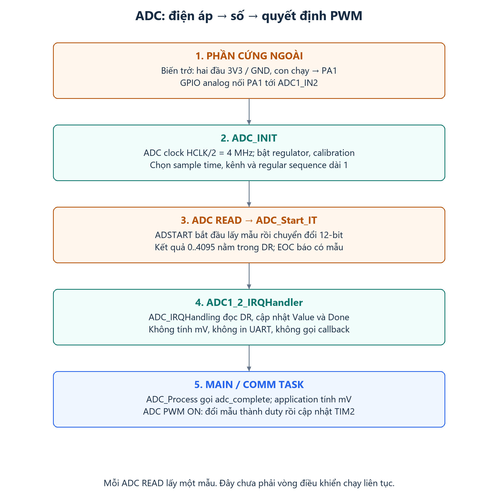

# Kiến trúc giao thức và ngoại vi: application → driver → hardware

**Bản đọc bằng trình duyệt:** [Mở tài liệu có sơ đồ và bảng đã hiển thị sẵn](protocol-architecture-guide.html).
Mở file HTML bằng trình duyệt; toàn bộ hình được nhúng sẵn và dùng được offline.

Tài liệu học tổng hợp cho chính project STM32F334R8 này. Mỗi phần trả lời bốn
câu hỏi: **cấu trúc gồm gì, mỗi phần làm gì, vì sao cần nó, và code nào nối các phần lại**.
Các đường gọi mô tả implementation hiện tại; các tính năng chưa viết được ghi rõ.

UART, SPI, I2C và CAN là giao tiếp. Timer đếm thời gian; PWM tạo xung; ADC đổi
điện áp thành số. GPIO cấu hình chân vật lý; DMA chuyển dữ liệu;
NVIC phân phối ngắt; FreeRTOS lập lịch task và đồng bộ. Chúng phối hợp để chạy
giao tiếp, nhưng có trách nhiệm khác nhau.

## Mục lục

1. [Bức tranh application → driver → hardware](#layers)
2. [Cấu trúc thư mục và đường khởi động](#startup)
3. [Ý nghĩa Config, Handle, Register, Transaction và Callback](#structures)
4. [So sánh giao thức và chân đang dùng](#comparison)
5. [GPIO: cầu nối tới chân vật lý](#gpio)
6. [UART: byte stream, ngắt, DMA và buffer](#uart)
7. [SPI: transaction đồng thời gửi/nhận](#spi)
8. [I2C: địa chỉ, ACK/NACK và repeated START](#i2c)
9. [CAN: frame, filter, FIFO và mailbox](#can)
10. [FreeRTOS đặt ở đâu trong kiến trúc?](#rtos)
11. [Lần theo các lệnh thực tế](#walkthrough)
12. [Rà soát, kiểm chứng và cách debug](#review)
13. [Lộ trình thực hành và tài liệu gốc](#practice)
14. [GPIO input, EXTI và debounce nút nhấn](#gpio-input)
15. [Timer: clock, bộ đếm, update và callback](#timer)
16. [PWM: chu kỳ, duty và chân output](#pwm)
17. [ADC: lấy mẫu điện áp và liên kết ADC → PWM](#adc)

<a id="layers"></a>
## 1. Bức tranh application → driver → hardware



[Mở sơ đồ lớn](assets/protocols/layers.svg)

Đọc theo thứ tự: **ứng dụng yêu cầu → driver điều khiển → thanh ghi được ghi →
ngoại vi làm việc → tín hiệu ra chân**. Khi nhận được dữ liệu hoặc có lỗi,
ngắt cập nhật driver; ứng dụng lấy kết quả bằng Read, callback hoặc TX result.

Ví dụ ứng dụng muốn đọc nhiệt độ. Driver I2C chỉ biết địa chỉ và dãy byte cần
gửi/nhận; ứng dụng phải biết register nào chứa nhiệt độ và cách đổi byte thành °C.
Vì thế một bus hoạt động đúng chưa chứng minh ứng dụng giải mã đúng dữ liệu.

1. **Application – quyết định việc cần làm.** Nhận lệnh như `LED ON` hoặc
   `I2C READ`, hiểu dữ liệu nhận được và quyết định phản hồi.
   Xem [communication_demo.c](../src/app/communication_demo.c).

2. **Service – biến dữ liệu thô thành thông điệp.** Parser ghép byte thành
   một dòng lệnh; request/response chuyển công việc giữa các task.
   Xem [line_parser.c](../src/services/line_parser.c) và [rtos_demo.c](../src/rtos/rtos_demo.c).

3. **Driver – thực hiện yêu cầu giao tiếp.** Giữ handle, buffer, queue và tiến độ;
   cung cấp Init, Read/Write, Submit, Process và IRQHandling.
   Xem [thư mục drivers](../src/drivers).

4. **Register map – tên C của thanh ghi phần cứng.** Các cấu trúc như
   `USART_RegDef_t` giúp driver đọc/ghi đúng địa chỉ.
   Xem [STM32F334.h](../src/drivers/STM32F334.h).

5. **Hardware – phần cứng thật thực hiện truyền nhận.** Ngoại vi dịch bit,
   tạo clock, nhận dữ liệu; GPIO AF nối ngoại vi tới chân và mạch ngoài.
   Đối chiếu [ST RM0364](https://www.st.com/resource/en/reference_manual/rm0364-stm32f334xx-advanced-armbased-32bit-mcus-stmicroelectronics.pdf).

6. **Board – chọn cấu hình đúng với bo mạch.** Ví dụ PA2/PA3 cho UART,
   PB8/PB9 open-drain cho I2C. Board gọi GPIO_Init và cấu hình handle ngoại vi.
   Xem [board_peripherals.c](../src/app/board_peripherals.c).

7. **Core – quản lý ngắt và thời gian.** NVIC chọn ISR cần chạy, critical section
   bảo vệ trạng thái dùng chung, SysTick tạo mốc millisecond.
   Xem [STM32F334_CORE.c](../src/drivers/STM32F334_CORE.c).

### Ba luồng phải phân biệt

**Luồng điều khiển:** application gọi API → driver sửa thanh ghi → ngoại vi bắt
đầu công việc. Giá trị trả về có thể chỉ báo công việc đã vào queue.

**Luồng dữ liệu:** byte/frame từ dây → ngoại vi → RAM → parser/dispatcher →
application. Khi gửi thì đi ngược lại. Với DMA, dữ liệu đi giữa ngoại vi và RAM
qua DMA controller; CPU không phải copy từng byte từ data register.

**Luồng thực thi:** CPU chạy main hoặc một task. Khi có ngắt, CPU chạy ISR rồi
trở lại công việc trước đó hoặc chuyển task. Một API nhận dữ liệu bất đồng bộ
có thể return trước khi dữ liệu tới; state và buffer nối hai thời điểm này.

<a id="startup"></a>
## 2. Cấu trúc thư mục và đường khởi động

```text
src/
  startup/     vector table, Reset_Handler
  systerm/     SystemInit, khởi tạo constructor, memory helpers
  test/        main: chọn vòng lặp bare-metal hoặc FreeRTOS
  app/         pin map, handle, command, ISR chuyển tiếp
  services/    line parser độc lập phần cứng
  drivers/     register definitions, GPIO, core, UART/SPI/I2C/CAN
  rtos/        FreeRTOSConfig, task/queue/mutex, fault hooks
third_party/FreeRTOS-Kernel/  kernel và port chính thức đã ghim phiên bản
tests/         kiểm thử trên PC bằng register mock
```

Sau reset, [startup_stm32f334x8.s](../src/startup/startup_stm32f334x8.s) đặt MSP,
gọi `SystemInit`, copy `.data`, xóa `.bss`, chạy constructor rồi gọi `main`.
`SystemInit` hiện giữ clock HSI reset và đặt VTOR cho vector trong Flash.
[Linker script](../STM32F334R8_FLASH.ld) đặt code trong 64 KB Flash và dữ liệu
trong 12 KB SRAM thường; chừa ít nhất 1 KB cho stack MSP.



[Mở sơ đồ lớn](assets/protocols/startup.svg)

`Board_*Init` dùng GPIO API bạn đã viết, điền `pXXXx` và `XXX_Config`, rồi gọi
driver Init. Ví dụ `Board_UARTInit` chọn PA2/PA3 AF7; `UART_Init` cấu hình USART2
và DMA/NVIC. Chỉ đặt GPIO AF mà chưa Init ngoại vi thì chưa truyền được byte.

<a id="structures"></a>
## 3. Ý nghĩa Config, Handle, Register, Transaction và Callback

| Cấu trúc/khái niệm | Chứa gì? | Vì sao cần? | Ví dụ thực tế |
|---|---|---|---|
| `XXX_Config_t` | Tham số cấu hình | Biến ý định người dùng thành giá trị thanh ghi | `UART_BaudRate`, `SPI_CPOL`, `I2C_Timing`, `CAN_BitRate` |
| `XXX_Handle_t` | Con trỏ ngoại vi + Config + runtime | Giữ trạng thái qua nhiều lần gọi và nhiều ISR | `huart2`, `hspi1`, `hi2c1`, `hcan1` |
| `XXX_RegDef_t` | Các trường `volatile` theo offset | Gắn tên C với địa chỉ phần cứng | `huart2.pUSARTx->BRR` |
| Transaction | Yêu cầu một lần truyền/nhận | Tách việc Submit khỏi lúc bus thật sự chạy | `SPI_Transaction`, `I2C_Transaction` |
| Frame | Một thông điệp đã có biên phần cứng | Lưu đầy đủ ID, loại frame, DLC, payload | `CAN_Frame` |
| Ring buffer | Mảng byte + head/tail | Hấp thụ tốc độ đến khác tốc độ xử lý | UART RX/TX |
| Queue | Các item có kiểu xác định | Giữ thứ tự công việc hoặc chuyển dữ liệu giữa task | SPI transaction queue, CAN frame queue, RTOS request queue |
| State machine | Trạng thái hiện tại + chuyển trạng thái | Không phải chờ chặn tới khi xong một transfer | SPI `TRANSFER → WAIT_END`; I2C `WAIT_BUS → TX → RX` |
| Callback | Hàm được gọi sau khi có kết quả | Báo hoàn tất về application | `spi_complete`, `i2c_complete` |
| Stats/epoch | Counter và dấu mất liên tục | Quan sát quá tải/lỗi và đồng bộ lại parser | UART `rx_epoch`, I2C `nacks`, CAN `tx_failed` |

### Từ con trỏ C tới địa chỉ thật

Trong header, `USART2` là con trỏ tới base `0x40004400`. `TDR` nằm ở offset
`0x28`; vì vậy `huart2.pUSARTx->TDR` trỏ tới `0x40004428` khi handle chọn USART2.
Driver ghi địa chỉ đó vào DMA CPAR; DMA đọc TX ring ở CMAR và chuyển byte tới TDR.
Khối USART sau đó tự dịch bit ra PA2. Application không phải tự bật/tắt PA2 cho
từng bit UART.

`volatile` yêu cầu compiler thực hiện truy cập thanh ghi/bộ nhớ dùng chung cần
thiết. Nó không tạo mutex, không giữ một nhóm thao tác nguyên tử và không làm
API tự an toàn khi nhiều task cùng dùng. Driver vẫn cần critical section, còn
application vẫn cần quy định task nào sở hữu handle.

### Vòng đời và quyền sở hữu

```text
Handle global/static được zero-init
    → gán pXXXx và Config
    → Board cấu hình GPIO
    → XXX_Init(&handle)
    → Submit/Read/Write + Process; ISR gọi IRQHandling cùng handle
    → XXX_DeInit(&handle) thành công
    → được đổi Config hoặc chuyển handle sở hữu
```

Driver hiện chỉ hỗ trợ **USART2, SPI1 master 8-bit, I2C1 master 7-bit và CAN1**.
Tên API theo form HAL của project; header có thêm địa chỉ ngoại vi không đồng
nghĩa driver đã triển khai tất cả instance/chế độ đó.

UART Write copy byte vào TX ring nên input có thể tái sử dụng ngay. CAN Send
copy nguyên frame. SPI/I2C Submit chỉ copy descriptor: TX/RX/context phải còn
sống, không bị caller sửa tới callback. Không dùng lại cùng buffer cho hai
transfer đang chờ nếu chưa xác định rõ quyền sở hữu.

UART DeInit chủ động hủy dữ liệu đang chờ. SPI/I2C DeInit từ chối khi đang có
transaction hoặc callback; CAN DeInit từ chối TX active/queued và bỏ RX/result
chưa đọc khi thành công. Luôn kiểm tra kết quả Init/DeInit/Submit.

<a id="comparison"></a>
## 4. So sánh giao thức và chân đang dùng

| Giao tiếp | Cấu trúc dữ liệu trên dây | Clock/đồng bộ | Chọn đối tượng giao tiếp | Đơn vị phần mềm hiện tại |
|---|---|---|---|---|
| UART | Start, data, stop; demo 8N1 | Hai bên cùng baud, không có dây clock | Đường TX/RX đã nối | Byte stream; parser dòng ở application |
| SPI | Bit TX/RX theo từng xung SCK | Master phát SCK; CPOL/CPHA | CS riêng của thiết bị | Transaction full-duplex |
| I2C | START, address+R/W, data, ACK/NACK, STOP | SCL; thiết bị có thể stretch clock | Địa chỉ 7-bit trong bài | TX/RX hoặc write-read repeated START |
| CAN | Frame có ID, control, data, CRC/ACK, kết thúc | Các node đồng bộ theo bit timing | Broadcast theo ID; filter chọn frame nhận | Frame hoàn chỉnh và TX result |

| Ngoại vi | Chân demo | Chế độ điện/chức năng | Cấu hình hiện tại |
|---|---|---|---|
| LED | PA5 | GPIO output push-pull | Toggle bằng thời gian, không delay chặn |
| USART2 | PA2 TX, PA3 RX | AF7 | 115200, 8N1; RX IRQ hoặc DMA; TX DMA |
| SPI1 | PB3 SCK, PB4 MISO, PB5 MOSI, PB6 CS | AF5 cho bus, CS GPIO output | Master, 8-bit, MSB first, mode 0, PCLK2/16 |
| I2C1 | PB8 SCL, PB9 SDA | AF4 open-drain; cần pull-up ngoài | HSI8, TIMINGR `0x10420F13`, danh định 100 kHz |
| CAN1 | PA11 RX, PA12 TX | AF9; bus thật qua transceiver | 125 kbit/s; mặc định silent loopback |
| Nút ngoài | PB0 | Input pull-up, EXTI0 hai cạnh | Nhấn nối GND; debounce 30 ms trong main/task |
| TIM3 | Không dùng chân output | Timer nội + update IRQ | PSC=7999, ARR=99; chu kỳ 100 ms |
| TIM2 CH1 | PA0 | AF1 push-pull | PWM 1 kHz; duty 0–100%, mặc định dừng |
| ADC1 IN2 | PA1 | Analog, không pull-up/down | 12-bit; software trigger một mẫu + IRQ |

Đối chiếu chân/AF trong [datasheet STM32F334R8](https://www.st.com/resource/en/datasheet/stm32f334r8.pdf).
Tín hiệu logic UART của MCU cần mạch chuyển mức phù hợp nếu giao tiếp RS-232
hoặc RS-485. CAN_TX/CAN_RX nối với transceiver để ra CAN_H/CAN_L; không nối
thẳng chân logic MCU vào hai dây CAN bus.

<a id="gpio"></a>
## 5. GPIO: cầu nối tới chân vật lý

Nguồn: [GPIO header](../src/drivers/STM32F334_GPIO.h),
[GPIO implementation](../src/drivers/STM32F334.c).

| Thanh ghi | Chức năng | Ý nghĩa với application |
|---|---|---|
| RCC AHBENR | Bật clock GPIO port | Port có clock mới nhận cấu hình |
| MODER | Input/output/alternate/analog | Chọn GPIO tự điều khiển hay giao quyền cho ngoại vi |
| OTYPER | Push-pull/open-drain | SPI output khác I2C dùng pull-up |
| PUPDR | Pull-up/pull-down nội | Mức mặc định khi đường không được lái |
| AFR[0/1] | Mã alternate function từng pin | Chọn USART/SPI/I2C/CAN trên pin tương ứng |
| IDR | Mức input | Đọc tín hiệu đang thấy ở chân |
| ODR | Output latch | Trạng thái output phần mềm đã đặt |
| BSRR | Set/reset từng pin bằng một lần ghi | Tránh ghi đè cập nhật của pin khác khi có ISR |

`GPIO_WriteToOutputPin(GPIOA, 5, SET)` ghi bit 5 của BSRR; reset pin 5 ghi bit
21. Nó không ghi lại cả ODR. `GPIO_ToggleOutputPin` vẫn cần đọc trạng thái cũ,
nên các caller cùng sửa output port phải được đồng bộ nếu có cạnh tranh.

AF không thay thế cấu hình điện. Ví dụ PB8/PB9 cần vừa AF4 vừa open-drain.
Mạch pull-up bên ngoài tạo mức cao; open-drain kéo mức thấp hoặc nhả đường.
Chọn được AF4 mà để push-pull có thể làm bus I2C hoạt động sai.

`GPIO_DeInit(GPIOA)` reset **cả port**, không chỉ một pin. Trong demo PA2/PA3
và PA5 cùng port A; không reset port đang dùng UART chỉ để tắt LED.

<a id="uart"></a>
## 6. UART: byte stream, ngắt, DMA và buffer

Nguồn: [UART header](../src/drivers/STM32F334_UART.h),
[UART implementation](../src/drivers/STM32F334_UART.c).

### Cấu trúc và ý nghĩa

Một ký tự demo 8N1 có cấu trúc logic:

```text
Idle=1 | Start=0 | D0 D1 D2 D3 D4 D5 D6 D7 | Stop=1
                    8 data bit, LSB trước
```

UART phần cứng chuyển ký tự. Chuỗi `LED ON\n` là giao thức dòng do ứng dụng
đặt ra; ngoại vi không tự biết đó là một lệnh. `LineParser_Feed` giữ phần dòng
chưa hoàn chỉnh, xử lý nhiều dòng trong một batch và chỉ gọi `command` khi có LF.

| Phần của UART handle | Chức năng | Ý nghĩa |
|---|---|---|
| `UART_Config` | Clock, baud, RX mode, IRQ priority | Cấu hình ban đầu |
| `RxDMABuffer[256]` | DMA ghi raw byte liên tục | Buffer nhận đầu tiên của chế độ DMA |
| `RxBuffer[512]` | ISR/collector đưa byte vào; main/task lấy ra | Tách nhịp nhận khỏi nhịp parser; dùng được 511 ô |
| `TxBuffer[256]` | Write copy byte vào, DMA lấy từng span | Trả API sớm; dùng được 255 ô |
| Head/tail và `TxActiveLength` | Giữ vị trí/đoạn đang được sử dụng | Không giải phóng RAM khi DMA còn đọc |
| `Stats.rx_epoch` | Đổi khi luồng nhận mất liên tục | Parser phải bỏ dòng hỏng và đồng bộ lại |

### Kiến trúc RX



[Mở sơ đồ lớn](assets/protocols/uart-rx.svg)

Hai chế độ RX là lựa chọn thay thế; không để RXNE ISR và DMA cùng lấy RDR.
Trong chế độ DMA, HT báo nửa buffer, TC báo hết vòng, IDLE báo khoảng nghỉ.
IDLE giúp lấy đoạn cuối ngắn; HT/TC giúp xử lý stream không có khoảng nghỉ.
IDLE không phải bằng chứng đã đủ một packet ứng dụng.

`rx_dma_collect` kết hợp tiến độ TC và CNDTR, copy phần chưa lấy vào RX ring.
Collector không chỉ so sánh vị trí modulo vì đi hết một vòng có thể trở lại
cùng vị trí. Nửa buffer 128 byte ở 115200 8N1 mất khoảng 11,1 ms; ISR phải được
phục vụ kịp trước khi DMA ghi đè vùng cũ. Nhiều vòng bị ghi đè/cờ ngắt bị gộp
không thể phục hồi chỉ bằng một snapshot CNDTR.

### Kiến trúc TX và mốc hoàn tất

```text
text()/application → UART_Write → TxBuffer
  → UART_Process → DMA1 channel 7 → USART2 TDR → shift register → PA2
```

`UART_Write` trả số byte đã copy vào queue. DMA TC báo span RAM đã chuyển vào
ngoại vi, driver mới nhích tail. USART TC báo đã phát hết ký tự trên dây;
`UART_TxIdle` kiểm tra thêm mốc này. Khi đổi hướng RS-485 hoặc tắt transmitter,
cần xét wire completion, không chỉ DMA completion.

Nếu RX ring đầy, driver bỏ byte mới và tăng counter/epoch. Application lấy
epoch và byte trong cùng critical section, xóa phần chờ khi epoch đổi và yêu
cầu parser bỏ tới LF tiếp theo. Nhờ vậy không ghép hai mảnh trước/sau mất byte
thành một lệnh điều khiển sai.

<a id="spi"></a>
## 7. SPI: transaction đồng thời gửi/nhận

Nguồn: [SPI header](../src/drivers/STM32F334_SPI.h),
[SPI implementation](../src/drivers/STM32F334_SPI.c).

### Cấu trúc và ý nghĩa

Master tạo SCK; MOSI mang dữ liệu tới slave, MISO mang dữ liệu về master. Một
xung clock trao đổi bit theo cả hai hướng. CS chọn thiết bị và bao transaction.
Ý nghĩa command/address/dummy byte bên trong transaction phụ thuộc datasheet
thiết bị; SPI bus không tự định nghĩa register map của sensor/Flash.

| Mode | CPOL: SCK khi idle | CPHA: cạnh lấy mẫu | Cạnh lấy mẫu thực tế |
|---:|---:|---|---|
| 0 | 0 | Cạnh thứ nhất | Lên |
| 1 | 0 | Cạnh thứ hai | Xuống |
| 2 | 1 | Cạnh thứ nhất | Xuống |
| 3 | 1 | Cạnh thứ hai | Lên |

Xem giải thích [SPI modes trong tài liệu Linux kernel](https://kernel.org/doc/html/v5.16/spi/spi-summary.html).
Trong code, mode/speed thuộc `SPI_Config` và được chụp vào `ConfiguredCR1` khi
Init. Muốn đổi chúng: đợi hết công việc, DeInit, đổi Config, Init lại.

| Cấu trúc | Chức năng | Ý nghĩa |
|---|---|---|
| `SPI_Config_t` | Master, data size, CPOL/CPHA, divisor, priority | Thiết lập bus trước khi truyền |
| `SPI_Transaction` | CS, TX/RX pointer, length, timeout, callback/context | Một yêu cầu đang chờ hoặc đang chạy |
| `Queue[4]`, `Active` | Bốn descriptor chờ + một active | Chỉ một transfer sở hữu bus tại mỗi thời điểm |
| `TxCount`, `RxCount`, `State` | Theo dõi tiến độ từng chiều | Không nhầm đã nạp TX với đã nhận xong |

### Từ API xuống bus và quay về callback



[Mở sơ đồ lớn](assets/protocols/spi.svg)

Driver này dùng **IRQ**, chưa dùng SPI DMA. Để dễ học, chỉ cho một byte đang
chờ RX: nhận byte đó rồi gửi byte tiếp. `tx=NULL` tạo clock bằng byte `0xFF`;
`rx=NULL` vẫn đọc DR nhưng bỏ dữ liệu để tránh overflow. DR được truy cập 8 bit
để không vô tình đóng gói thêm byte trong cấu hình 8-bit.

Nhận đủ byte chưa phải lý do tùy tiện cắt clock. Process đợi ngoại vi hết bận
trước khi nhả CS; khi lỗi/timeout sẽ reset controller và báo callback lỗi.
Callback chạy sau khi khôi phục IRQ, không chạy bên trong SPI ISR.

<a id="i2c"></a>
## 8. I2C: địa chỉ, ACK/NACK và repeated START

Nguồn: [I2C header](../src/drivers/STM32F334_I2C.h),
[I2C implementation](../src/drivers/STM32F334_I2C.c).

### Cấu trúc và ý nghĩa

SCL và SDA dùng open-drain cùng pull-up. START mở giao tiếp; địa chỉ chọn thiết
bị; bit R/W chọn chiều; ACK/NACK xác nhận từng byte; STOP nhả bus. Địa chỉ thiết
bị và địa chỉ register trong thiết bị là hai khái niệm riêng.

Demo nhận address `0x50` chưa dịch. Khi phát, driver tạo byte địa chỉ `0xA0`
cho write hoặc `0xA1` cho read. Các byte TX sau địa chỉ được hiểu theo thiết bị;
demo dùng một byte register `0x00`, nhưng thiết bị khác có thể cần prefix khác.

```text
Đọc register:
START | Address+W | ACK | Register | ACK |
REPEATED START | Address+R | ACK | Data | master NACK | STOP
```

NACK mà master phát sau byte đọc cuối là cách kết thúc đọc bình thường.
`I2C_NACK` trong driver báo phía bên kia không ACK khi controller đang giao
tiếp, chẳng hạn không có thiết bị ở địa chỉ đó. Xem [RM0364: I2C master receive](https://www.st.com/resource/en/reference_manual/rm0364-stm32f334xx-advanced-armbased-32bit-mcus-stmicroelectronics.pdf).

| Phần mềm/thanh ghi | Chức năng | Ý nghĩa |
|---|---|---|
| `I2C_Config.I2C_Timing` → TIMINGR | Clock/timing bus | Không thay bằng baud divider UART |
| `I2C_Transaction.address` | Địa chỉ 7-bit chưa dịch | Driver đặt vào SADD đúng vị trí |
| TX/RX pointer + hai length | Chọn TX-only, RX-only hoặc TX→RX | Hai pha dùng cùng một transaction khi repeated START |
| CR2 | SADD, chiều, NBYTES, START, AUTOEND | Ra lệnh cho controller thực thi pha |
| TXIS/RXNE | Data register cần ghi/có byte đọc | ISR chuyển tối đa dữ liệu cần xử lý |
| TC | Pha write đã hết NBYTES ở chế độ không AUTOEND | Điểm tạo repeated START sang read |
| STOPF | Phần cứng phát hiện STOP | Đóng transaction; chưa gọi callback trong ISR |
| ICR | Xóa cờ bằng write-one-to-clear | Ghi mask đúng cờ, không OR toàn bộ status |

### State machine của driver hiện tại



[Mở sơ đồ lớn](assets/protocols/i2c.svg)

Một phase giới hạn 255 byte; driver chưa có RELOAD, 10-bit hay address-only
probe. Nó không tự retry. Bus bận được chờ có deadline; ARLO không ép STOP
lên master thắng arbitration. Khi đã yêu cầu dừng do lỗi, có grace period hữu
hạn trước khi reset controller. Reset controller không bảo đảm giải cứu được
slave đang giữ SDA/SCL thấp; đó là vấn đề bus vật lý riêng.

Trong bare-metal, main gọi I2C Process. Trong RTOS, chỉ I2CWorker gọi API này;
callback luôn ở cùng ngữ cảnh xử lý Process.

<a id="can"></a>
## 9. CAN: frame, filter, FIFO và mailbox

Nguồn: [CAN header](../src/drivers/STM32F334_CAN.h),
[CAN implementation](../src/drivers/STM32F334_CAN.c).

### Cấu trúc và ý nghĩa

CAN truyền frame có ID; phần mềm không phải ghép byte bằng newline như UART.
Các trường logic gồm mở frame, arbitration/ID, control/DLC, data, CRC, ACK và
kết thúc. Đây là mô tả khái niệm, không phải sơ đồ đầy đủ bit stuffing/delimiter.
Driver hiện hỗ trợ classical CAN: standard ID 11 bit hoặc extended ID 29 bit,
data frame và RTR, tối đa 8 byte payload; không phải CAN FD.

ID mô tả loại/thứ tự ưu tiên thông điệp theo quy ước hệ thống, không nhất thiết
là địa chỉ một node. Với các frame cùng loại đang tranh bus, ID nhỏ có ưu tiên
arbitration cao hơn. ACK ở bus cũng không có nghĩa application bên kia đã xử
lý xong nội dung payload.

| Cấu trúc | Chức năng | Ý nghĩa |
|---|---|---|
| `CAN_Config_t` | PCLK1, bitrate, normal/loopback, IRQ priority, TX timeout | Điều khiển bit timing và chế độ controller |
| `CAN_Frame` | `id`, `dlc`, `extended`, `remote`, `data[8]` | Một frame có biên rõ ràng |
| Hardware filter | Chọn frame vào FIFO | Demo filter mask 0 nhận mọi frame vào FIFO0 |
| Hardware RX FIFO0/1 | Đệm ngắn trước khi CPU lấy frame | ISR phải release sau khi copy |
| Software RX queue[8] | Giữ frame chờ main/Comm xử lý | Không giữ FIFO phần cứng trong lúc application làm việc |
| Software TX queue[8] | Chờ mailbox trống | Send trả true khi nhận yêu cầu, chưa phát xong |
| Ba TX mailbox + `inflight[3]` | Theo dõi frame đã giao hardware | Không tái sử dụng mailbox trước completion |
| TX result queue[8] | Frame gốc + status + ESR | Application biết yêu cầu nào thành công/thất bại |



[Mở sơ đồ lớn](assets/protocols/can.svg)

TX timeout không giải phóng mailbox ngay khi ghi ABRQ. Driver chờ RQCP xác
nhận đã kết thúc/abort, rồi mới xuất TX result và cho dùng lại mailbox. Khi
bus-off, driver theo dõi ESR và ABOM; frame pending trong software queue được
giữ, frame đang chạy được xử lý bằng đường abort/result.

Demo `CAN TEST` chạy silent loopback, không kiểm chứng transceiver, dây, ACK
hay bit timing của một mạng thực. Khi chuyển normal mode cần bus và node ACK
phù hợp. Logic bus/frame của bxCAN được mô tả trong [ST RM0364](https://www.st.com/resource/en/reference_manual/rm0364-stm32f334xx-advanced-armbased-32bit-mcus-stmicroelectronics.pdf).

<a id="rtos"></a>
## 10. FreeRTOS đặt ở đâu trong kiến trúc?

RTOS thay cách tổ chức thực thi application; các thanh ghi và tín hiệu UART,
SPI, I2C, CAN vẫn là các khối phần cứng đó. Driver không cần gọi kernel để
truyền một byte. Cầu nối ngắt/task được đặt ở application.

| Ngữ cảnh | Sở hữu | Công việc chính |
|---|---|---|
| Bare-metal main | Các handle demo | Gọi Process luân phiên, không delay chặn |
| RTOS Comm, priority 2 | UART/SPI/CAN, parser, LED, terminal | Process các driver đó; nhận I2C response; delay 1 tick |
| RTOS I2CWorker, priority 1 | I2C handle và transfer active | Chờ request, submit I2C, chờ IRQ hint/timeout, Process |
| RTOS Producer, priority 1 | Lịch phát yêu cầu | Khi được bật, queue request mỗi 2000 ms |
| ISR | Phần trạng thái/byte cần cập nhật nhanh | IRQHandling; riêng I2C thêm notification sau driver |

Request queue copy **address/register**; response queue copy **kết quả/byte RX**.
Worker giữ TX/RX/context trên stack của chính nó tới khi callback đã hoàn tất.
Comm không sửa handle I2C và Worker không in UART. Nhờ vậy không phải khóa bus
trong lúc task khác chờ giao tiếp.

Stats mutex bảo vệ counter/snapshot giữa task. Không giữ nó trong lúc gọi
driver, đợi queue hoặc in terminal. Task notification chỉ là tín hiệu kiểm tra
lại trạng thái, không mang packet và không tự chứng minh transfer thành công.

```text
I2C1_EV_IRQHandler
  → I2C_EVIRQHandling(&hi2c1): chuyển byte/state dưới critical section
  → khôi phục PRIMASK
  → RTOS_I2CNotifyFromISR: vTaskNotifyGiveFromISR, có thể pend chuyển task
  → I2CWorker thức dậy: I2C_Process, callback, queue response
```

NVIC priority số nhỏ ưu tiên cao; task priority số lớn ưu tiên cao. I2C IRQ
priority 6 được phép gọi FromISR với threshold 5. SPI IRQ priority 3 không gọi
kernel. Không gọi mutex hoặc API có thể block trong `IRQ_Save`/ISR.

SysTick wrapper tăng millisecond và chuyển tick cho kernel sau khi scheduler
bắt đầu. SVC/PendSV trỏ thẳng vào port. Bản RTOS dùng static task/queue/mutex,
không có FreeRTOS heap. Port ARM_CM3 phục vụ đường chạy Cortex-M4 software-float
hiện tại; không lưu context FPU. Chi tiết tại [rtos_demo.c](../src/rtos/rtos_demo.c),
[FreeRTOSConfig.h](../src/rtos/FreeRTOSConfig.h) và
[bài I2C/FreeRTOS](i2c-freertos-learning.md).

<a id="walkthrough"></a>
## 11. Lần theo các lệnh thực tế

### 11.1 `LED ON`: liên kết đủ application → driver → pin

```text
Terminal gửi "LED ON\n"
  → PA3 / USART2 / RDR
  → DMA RX hoặc RXNE ISR
  → huart2.RxBuffer
  → console_process: UART_Read
  → LineParser_Feed: nhận đủ LF
  → command: nhận diện "LED ON"
  → GPIO_WriteToOutputPin(GPIOA, 5, SET)
  → ghi GPIOA BSRR
  → output latch PA5 lên mức cao
  → text("OK"): UART TX ring → DMA TX → TDR → PA2 → terminal
```

Đặt breakpoint lần lượt ở `console_process`, `LineParser_Feed`, `command`,
`GPIO_WriteToOutputPin`. Chú ý: phần parser và lệnh chạy ở main/Comm task,
không ở USART ISR. Đèn có thay đổi thật hay không còn phụ thuộc phần điện của
LED và board; source mô tả mức logic đã yêu cầu.

### 11.2 `SPI TEST`: Submit và callback ở hai thời điểm

1. `command` tạo descriptor trỏ tới `spi_tx`/`spi_rx` static và callback.
2. `SPI_Submit(&hspi1, ...)` copy descriptor vào queue và return.
3. Lần `SPI_Process` tiếp theo lấy descriptor, cấu hình bus, kéo CS thấp.
4. IRQ TXE/RXNE điền byte TX/RX, cập nhật tiến độ.
5. Process thấy đủ RX và hardware hết bận, nhả CS, gọi `spi_complete`.
6. Callback in RX bằng UART API; phần cứng UART gửi sau đó.

Loopback bằng dây nối PB5→PB4 chỉ kiểm tra đường truyền/nhận demo; nó không
kiểm tra command hay timing yêu cầu bởi một sensor SPI cụ thể.

### 11.3 `I2C READ` ở FreeRTOS: thêm lớp task queue



[Mở sơ đồ lớn](assets/protocols/i2c-rtos.svg)

Địa chỉ/register mẫu nằm trong `demo_config.h`. Bản bare-metal bỏ hai queue
RTOS: command submit trực tiếp, main Process và callback in kết quả.

### 11.4 `CAN TEST`: hai đường RX và TX completion

```text
command → CAN_Send copy CAN_Frame → TX queue → mailbox → bxCAN loopback
  ├─ RX: filter/FIFO → CAN RX IRQ → RX queue → CAN_Receive → in payload
  └─ TX: RQCP → collect_completions → TX result queue → CAN_GetTxResult
```

Không dùng việc thấy frame RX để bỏ qua kiểm tra TX result của API. Hai đường
có mục đích riêng và không nên dựa vào thứ tự IRQ để xác định ý nghĩa dữ liệu.

<a id="review"></a>
## 12. Rà soát, kiểm chứng và cách debug

### Những ranh giới đã kiểm tra trong source

| Ranh giới | Điều cần đúng | Cách project thực hiện |
|---|---|---|
| Application → driver | Biết yêu cầu đã nhận hay đã xong | Write trả số byte; Submit/Send trả acceptance; callback/TX result báo hoàn tất |
| Driver → RAM | Buffer còn sống, không dùng lại quá sớm | Ring giữ tail tới DMA TC; SPI/I2C giữ pointer tới callback; CAN copy frame |
| Driver → register | Đúng offset, kích thước truy cập và cách xóa flag | Static assertions; SPI DR 8-bit; ICR/IFCR/EXTI PR ghi mask W1C |
| Register → pin | Clock, AF, electrical mode, thiết bị ngoài phù hợp | Board config qua GPIO API; I2C OD; CAN transceiver cho normal mode |
| ISR → application | ISR hữu hạn, không chạy parser/user callback | IRQHandling cập nhật state; Process/callback ở main/task |
| Task → task | Không chia sẻ handle tùy tiện | Comm sở hữu UART/SPI/CAN/TIM/ADC và IO; Worker sở hữu I2C; queue copy giá trị |
| Timeout → recovery | Không đợi vô hạn hoặc tái dùng tài nguyên đang active | I2C WAIT_BUS deadline/STOP grace; CAN chờ RQCP sau abort; SPI reset khi timeout |

Trong đợt rà soát này, GPIO ghi từng pin đã chuyển từ RMW ODR sang BSRR, kèm
regression test. `GPIO_ToggleOutputPin` vẫn là thao tác dựa vào giá trị cũ và
được ghi rõ yêu cầu đồng bộ khi có nhiều caller.

### Debug từ lớp nào khi thấy lỗi?

| Triệu chứng | Kiểm tra từ dưới lên | Đích quan sát trong code |
|---|---|---|
| UART không thấy byte | Dây/GND/baud/AF → USART enable → DMA/IRQ → ring | BRR, ISR, CNDTR, `UART_Stats`, `console_process` |
| UART có byte nhưng không chạy lệnh | LF/CRLF → parser → command | `parser.length`, `discarding`, `rx_epoch`, `rejected_lines` |
| SPI RX toàn FF/00 | MISO/CS/GND → mode/clock → DR → descriptor | CR1/CR2/SR, TxCount/RxCount, callback result |
| I2C NACK | Pull-up và địa chỉ → đúng 7-bit → thiết bị sẵn sàng | NACKF, transaction address, `Stats.nacks` |
| I2C timeout | SCL/SDA mức idle → BUSY → IRQ → Process còn được chạy | State, StartedMs/AbortMs, `Stats.timeouts` |
| CAN Send true nhưng không có TX OK | Queue/mailbox → bus thật/ACK → lỗi controller | `CAN_GetTxResult`, ESR, inflight, timeout/bus-off counter |
| RTOS chỉ một task chạy | Task priority → có block/delay không → mutex/queue | task state, high-water mark, `g_rtos_fault_*` |
| Có IRQ nhưng không callback | IRQ wrapper đúng handle → state DONE → Process | [interrupts.c](../src/app/interrupts.c), owner/Initialized, vòng gọi Process |

### Kết quả rà soát của bản code hiện tại

| Kiểm tra | Kết quả |
|---|---|
| Bare-metal Debug và Release | Build thành công với `-Werror` |
| FreeRTOS Debug và Release | Build thành công với `-Werror` |
| Native tests GPIO/parser/UART/SPI/I2C/CAN/TIM-PWM/ADC | 8/8 bộ kiểm thử đạt |
| Vector ngắt | 14 entry cho mỗi bản bare-metal, 16 cho mỗi bản RTOS đúng địa chỉ handler |
| Liên kết | Không có symbol chưa giải quyết; bản RTOS không liên kết heap/malloc |
| Nguồn FreeRTOS | 28 file upstream khớp manifest SHA256 |
| Tài liệu | UTF-8, code fence và liên kết file/anchor nội bộ đã kiểm tra |

| Bản build | Flash: text + data | RAM tĩnh: data + bss |
|---|---:|---:|
| debug | 20.260 B | 2.464 B |
| release | 35.536 B | 2.464 B |
| rtos-debug | 29.124 B | 7.324 B |
| rtos-release | 48.756 B | 7.324 B |

RAM tĩnh của RTOS đã bao gồm stack task; vẫn cần vùng MSP riêng cho startup/ISR.
Các số này là snapshot của lần rà soát, sẽ đổi khi sửa code/cấu hình.

Sau khi build đủ bốn preset, có thể chạy lại kiểm tra artifact và tài liệu:

```powershell
python tests/verify_artifacts.py
```

Script [verify_artifacts.py](../tests/verify_artifacts.py) cần các công cụ
`arm-none-eabi-nm`, `arm-none-eabi-objcopy`, `arm-none-eabi-size` trên PATH.
Các native tests chạy riêng bằng CMake project `tests/` như hướng dẫn I2C/FreeRTOS.

### Mức kiểm chứng và giới hạn

Build Debug/Release kiểm tra code ARM và liên kết; register mock trên PC kiểm
tra state/buffer/lifecycle. Kiểm tra vector xác nhận ISR thật được nối vào
đúng vị trí và SVC/PendSV của RTOS không rơi vào Default_Handler. Manifest hash
giúp đối chiếu nguồn FreeRTOS vendored không bị sửa.

Những kiểm tra đó không đo mức điện, cạnh clock, độ trễ thực, stack margin ở
mọi đường chạy hay chứng minh scheduler hoạt động trên silicon. Chưa có thử
nghiệm board thực tế trong phiên này. Cần nạp firmware và đo/quan sát thiết bị
ngoài; không suy ra bus thật tốt chỉ từ loopback hoặc build thành công.

Các giới hạn implementation phải nhớ: UART 8N1/USART2; SPI1 master 8-bit IRQ;
I2C1 master 7-bit, tối đa 255 byte mỗi pha và không address-only probe; CAN cổ
điển tối đa 8 byte; chưa có lớp driver sensor/Flash cụ thể. Không có SPI/I2C DMA
trong bản này. FreeRTOS dùng software floating point và static allocation.

<a id="practice"></a>
## 13. Lộ trình thực hành và tài liệu gốc

1. Đọc Config/Handle rồi lần theo `Board_UARTInit` và `UART_Init`; xác định
   tham số nào thuộc board, tham số nào thuộc ngoại vi.
2. Gửi `LED ON`, theo đường UART → parser → GPIO → BSRR; phân biệt dữ liệu
   nhận được với ý nghĩa của dữ liệu đó.
3. So sánh UART RXNE và DMA bằng `DEMO_UART_USE_DMA`; parser giữ nguyên.
4. Nối SPI loopback rồi theo TxCount/RxCount và callback; quan sát lý do phải
   chờ hardware hết bận trước khi nhả CS.
5. Thử `I2C READ` với địa chỉ/register đúng thiết bị; đối chiếu một lần đọc
   logic analyzer với START/ACK/repeated START/NACK/STOP trong tài liệu.
6. Thử CAN loopback trước, đọc cả RX frame lẫn TX result; sau đó mới sang
   normal mode với transceiver/node/bus đúng cấu hình.
7. Chuyển `rtos-debug`, theo request queue → Worker → IRQ → response queue;
   kiểm tra task nào sở hữu từng buffer và nơi nào được phép gọi FromISR.

Các hướng dẫn thao tác chi tiết:

- [UART/SPI/CAN và form driver giống GPIO](communication-learning.md).
- [I2C/FreeRTOS: nối dây, build, task, queue và bài tập](i2c-freertos-learning.md).
- [README: lệnh build và các preset](../README.md).
- [ST RM0364: ngoại vi, DMA, NVIC, memory map](https://www.st.com/resource/en/reference_manual/rm0364-stm32f334xx-advanced-armbased-32bit-mcus-stmicroelectronics.pdf).
- [ST STM32F334R8 datasheet: pin/AF và đặc tính điện](https://www.st.com/resource/en/datasheet/stm32f334r8.pdf).
- [ST register definitions để đối chiếu](https://github.com/STMicroelectronics/cmsis-device-f3/blob/master/Include/stm32f334x8.h).
- [FreeRTOS V11.3.3 API task](https://github.com/FreeRTOS/FreeRTOS-Kernel/blob/V11.3.3/include/task.h), [queue](https://github.com/FreeRTOS/FreeRTOS-Kernel/blob/V11.3.3/include/queue.h), [mutex](https://github.com/FreeRTOS/FreeRTOS-Kernel/blob/V11.3.3/include/semphr.h).
- [Bản kernel, commit và hash đã ghim](../third_party/FreeRTOS-Kernel/UPSTREAM.md).

<a id="gpio-input"></a>
## 14. GPIO input, EXTI và debounce nút nhấn

GPIO có bốn vai trò trong demo: PA5 làm output điều khiển LED, PB0 làm input
nút nhấn, PA0 ở alternate function cho timer PWM, PA1 ở analog cho ADC.
Application chọn mục đích; board chọn chân/mode; GPIO driver ghi thanh ghi.
GPIO không tự biết một mức thấp có nghĩa là “người dùng nhấn nút”.



[Mở sơ đồ lớn](assets/protocols/gpio-events.svg)

### Cấu trúc, chức năng và ý nghĩa

| Thành phần | Chức năng | Vì sao cần |
|---|---|---|
| `GPIO_PinConfig` | Chọn pin, mode, pull-up/down, tốc độ, output type, AF | Tách cấu hình chân khỏi logic ứng dụng |
| `GPIO_Handle_t` | Ghép địa chỉ port với cấu hình | Cùng API áp dụng cho nhiều pin/port |
| SYSCFG EXTICR | Nối PB0 tới EXTI line 0 | PA0/PB0 cùng số pin dùng chung line, phải chọn port |
| EXTI RTSR/FTSR, IMR | Chọn cạnh lên/xuống và cho phép ngắt | Phát hiện thay đổi mà không polling liên tục |
| EXTI PR | Lưu sự kiện đang chờ; ghi 1 để xóa | ISR xác nhận đúng line đã được phục vụ |
| `gpio_edges` | ISR đếm cạnh quan sát được | Giữ ISR ngắn; cạnh điện chưa phải lần nhấn hợp lệ |
| `stable_input`, `changed_ms`, `presses` | Main/task xác nhận mức ổn định sau 30 ms | Loại dội tiếp điểm bằng phần mềm |

Đường gọi thật: `Board_GPIOInputInit` → `GPIO_Init` cấu hình input, pull-up,
SYSCFG/EXTI → `GPIO_IRQConfig` bật NVIC. Khi PB0 đổi mức:
`EXTI0_IRQHandler` → `IO_Demo_GPIOIRQ` → `GPIO_IRQHandling(0)` xóa pending và
đếm cạnh. `IO_Demo_Process` mới debounce rồi quyết định in sự kiện.

Debounce tính từ cạnh cuối mà phần mềm đã quan sát; thời gian phản hồi gồm
30 ms và độ trễ main/task. Nếu chặn CPU hoặc che IRQ lâu, nhiều cạnh có thể
bị gộp trong một pending bit. Đây không phải bộ đếm xung chính xác cho encoder.
ISR không delay, không in UART. Nút đang giữ lúc khởi động là trạng thái ban
đầu, chưa được tính là một lần nhấn mới.

### Thử trên board

Nối **nút ngoài giữa PB0 và GND**, dùng pull-up nội. Đây không phải cấu hình
nút B1 có sẵn trên Nucleo. Gửi từng dòng bằng terminal UART:

```text
GPIO READ
GPIO WATCH ON
GPIO READ
GPIO WATCH OFF
LED ON
LED OFF
```

Khi nhả nút, PB0 thường bằng 1; khi nhấn bằng 0. `edges` có thể tăng nhiều
hơn `debounced presses`. Đó là điểm để quan sát sự khác nhau giữa cạnh điện
và sự kiện ứng dụng. `GPIO READ` trả mức tức thời và bộ đếm lần nhấn đã debounce.

Nguồn để lần theo: [GPIO API](../src/drivers/STM32F334_GPIO.h),
[GPIO driver](../src/drivers/STM32F334.c),
[board configuration](../src/app/board_peripherals.c),
[IO application](../src/app/io_demo.c), [ISR wrappers](../src/app/interrupts.c).

<a id="timer"></a>
## 15. Timer: clock, bộ đếm, update và callback

Timer là phần cứng đếm xung clock ngay cả khi CPU chạy việc khác. Demo dùng
**TIM3 làm timer chu kỳ 100 ms**, độc lập với SysTick 1 ms của timebase/FreeRTOS.
PWM ở phần sau dùng TIM2 riêng, nên đổi duty không đổi lịch TIM3.



[Mở sơ đồ lớn](assets/protocols/timer-pwm.svg)

### Cấu trúc và chức năng

| Phần | Chức năng | Ý nghĩa |
|---|---|---|
| `TIM_Config_t` | Timer clock, PSC, ARR, mode, priority | Các giá trị ban đầu do board quyết định |
| `TIM_Handle_t` | Địa chỉ timer, cấu hình, state, counter, callback/context | Mỗi timer có trạng thái riêng; một owner main/task |
| PSC | Chia clock đầu vào theo `PSC+1` | Tạo độ phân giải của bộ đếm |
| CNT | Bộ đếm hiện tại | Đếm từ 0 tới ARR trong chế độ up-counting |
| ARR | Auto-reload; chu kỳ có `ARR+1` tick | Quyết định khoảng thời gian giữa các update |
| EGR.UG | Tạo update bằng phần mềm | Nạp PSC/ARR preload khi khởi tạo/start |
| DIER.UIE / SR.UIF | Cho phép update IRQ / cờ update | Nối sự kiện timer tới NVIC và ISR |
| `PendingUpdates` | Gom số IRQ chưa xử lý | Task xử lý callback sau, không chạy user code trong ISR |

Với edge-aligned up-counting:

```text
f_counter = f_timer / (PSC + 1)
f_update  = f_timer / ((PSC + 1) × (ARR + 1))

TIM3: 8.000.000 / (7999 + 1) = 1000 tick/s
      1000 / (99 + 1) = 10 update/s → chu kỳ 100 ms
```

`TIM_ClockHz` là clock timer thực tế, không mặc định bằng CPU clock. Với TIM2/3,
APB1 prescaler bằng 1 thì timer dùng PCLK1; nếu APB1 bị chia thì timer dùng
2 × PCLK1. Driver nhận clock từ board, không tự đổi clock tree. Project đang
giữ HSI/HCLK/PCLK1 ở 8 MHz nên `DEMO_TIMER_HZ = 8000000`.

### Application → driver → hardware → application

1. `IO_Demo_Init` → `Board_TimerInit`: chọn TIM3, PSC=7999, ARR=99.
2. `TIM_Init` bật RCC, reset timer, ghi PSC/ARR, tạo UG nạp preload rồi xóa
   cờ update do chính UG tạo ra. Init chưa tính đây là một chu kỳ đã trôi qua.
3. `TIM_Start_IT` bật UIE, NVIC và CR1.CEN. Phần cứng bắt đầu đếm.
4. Tràn bộ đếm → UIF → `TIM3_IRQHandler` → `TIM_IRQHandling` xóa UIF,
   tăng `Updates` và `PendingUpdates`.
5. `CommunicationDemo_Process` → `IO_Demo_Process` → `TIM_Process` lấy số
   pending và gọi `timer_elapsed(count, context)` ở main hoặc Comm task.

Callback có thể nhận `count > 1` nếu task chưa xử lý kịp nhiều IRQ.
`TIMER STATS` hiển thị `updates` được ISR ghi nhận và `processed` được callback
xử lý; hai số có thể lệch tạm thời. Nếu che IRQ qua nhiều chu kỳ, UIF chỉ giữ
một bit nên không thể khôi phục số chu kỳ đã mất. `DroppedUpdates` chỉ phản
ánh tràn bộ đếm pending trong phần mềm, không đo được các sự kiện bị gộp ấy.

**Cách xóa cờ khác nhau:** TIM SR dùng ghi **0** để xóa; driver ghi `SR = ~UIF`
để giữ cờ khác. EXTI PR và ADC ISR dùng ghi **1** để xóa. Không áp dụng một
công thức `|=` chung cho mọi status register.

Timer tự chạy ngay sau init demo. Thử:

```text
TIMER STATS
TIMER STOP
TIMER STATS
TIMER START
TIMER STATS
```

`Stop` bỏ callback đang pending, giữ counter thống kê tích lũy. Start bắt đầu
chu kỳ mới; gọi Start khi đã chạy trả thất bại. `TIM_DeInit` chỉ thành công
khi đã dừng và không ở trong callback. TIM3 ARR tối đa 65535 vì là timer 16-bit.

Đọc [TIM API](../src/drivers/STM32F334_TIM.h) rồi
[TIM implementation](../src/drivers/STM32F334_TIM.c); đối chiếu đường gọi tại
[io_demo.c](../src/app/io_demo.c) và [interrupts.c](../src/app/interrupts.c).

<a id="pwm"></a>
## 16. PWM: chu kỳ, duty và chân output

PWM dùng timer để đổi tỷ lệ thời gian mức high trong mỗi chu kỳ. Demo dùng
**TIM2 channel 1 → PA0 AF1**, PWM mode 1, active high, edge-aligned.
Đây là tín hiệu số giữa low/high; muốn điện áp analog mượt cần mạch lọc phù hợp.

| Thành phần | Chức năng | Ý nghĩa trong demo |
|---|---|---|
| PSC, ARR | Tạo chu kỳ PWM | PSC=7, ARR=999 → 1 kHz, chu kỳ 1 ms |
| CCR1 | Ngưỡng so sánh CNT | CNT < CCR1 thì output high |
| CCMR1.OC1M | Chọn PWM mode 1 hoặc forced inactive | Phát PWM khi chạy, ép low khi dừng |
| CCMR1.OC1PE | Bật preload CCR1 | Duty mới có hiệu lực ở update kế tiếp |
| CCER.CC1E | Cho phép channel output | Nối tín hiệu so sánh tới output timer |
| GPIO AFRL/MODER | Chọn AF1 trên PA0 | Đưa TIM2_CH1 ra chân thay vì GPIO ODR |
| `DutyPermille` | Giá trị 0–1000 | API driver dùng độ phân giải 0,1%; CLI dùng phần trăm |

```text
f_PWM = 8.000.000 / ((7 + 1) × (999 + 1)) = 1000 Hz
duty  = CCR1 / (ARR + 1)

  0% → CCR1 =    0 → luôn low
 25% → CCR1 =  250 → high 250 µs, low 750 µs
 50% → CCR1 =  500 → high 500 µs, low 500 µs
100% → CCR1 = 1000 → luôn high vì CNT chỉ tới 999
```

Đường gọi: lệnh `PWM 25` → `IO_Demo_Command` →
`TIM_PWM_SetDuty(&hpwm2, 250)` → CCR1 preload. `PWM START` →
`TIM_PWM_Start` bật channel/counter → phần cứng so sánh và tạo xung trên PA0.
CPU không cần đảo chân từng chu kỳ; nhánh PWM này không dùng IRQ.
Khi đang chạy, cập nhật duty không tạo UG, để thay đổi ở biên chu kỳ kế tiếp.

### Thử và quan sát

Nối đầu đo oscilloscope/logic analyzer vào PA0, GND về GND board:

```text
PWM 25
PWM START
PWM STATS
PWM 50
PWM 100
PWM 0
PWM STOP
```

Mặc định PWM dừng. Đặt duty khi dừng chỉ chuẩn bị giá trị cho lần Start;
đặt duty khi đang chạy cập nhật ngay ở chu kỳ tự nhiên kế tiếp. `PWM STOP`
ép channel low, giữ duty đã chọn để lần Start dùng lại. `ADC PWM OFF` chỉ
ngừng liên kết ADC → duty; muốn ngừng output phải dùng `PWM STOP`.

Driver hiện chỉ có TIM2 CH1 PWM và TIM3 base IRQ. Chưa có input capture,
encoder, center-aligned, complementary output, dead-time, PWM DMA hay HRTIM.
Nguồn PWM cùng [TIM driver](../src/drivers/STM32F334_TIM.c);
pin được chọn trong [Board_PWMInit](../src/app/board_peripherals.c).

<a id="adc"></a>
## 17. ADC: lấy mẫu điện áp và liên kết ADC → PWM

ADC biến điện áp tại chân thành số. Demo dùng **PA1 = ADC1_IN2**, 12-bit,
right-aligned, single-ended, software trigger, một mẫu mỗi `ADC READ`.
PA1 được cấu hình analog và không bật pull-up/down; đường này không dùng AF.



[Mở sơ đồ lớn](assets/protocols/adc-pwm.svg)

### Cấu trúc, chức năng và ý nghĩa

| Phần | Chức năng | Vì sao cần |
|---|---|---|
| `ADC_Config_t` | Clock hiện tại, channel, sample time, IRQ priority | Chọn cách lấy mẫu trước khi chạy |
| `ADC_Handle_t` | State Busy/Done, Value, timeout, thống kê, callback/context | Nối lúc gửi yêu cầu với lúc có kết quả |
| ADC12 common CCR.CKMODE | Chọn clock ADC đồng bộ HCLK/2 | HCLK8 → ADC4 MHz; không nhầm với PCLK1 |
| CR.ADVREGEN / ADCAL / ADEN | Bật regulator, tự calibration, enable ADC | Chuẩn bị khối analog trước khi đo |
| SMPR1/2 | Thời gian nạp tụ sample-and-hold | Nguồn trở kháng cao cần thời gian ổn định phù hợp |
| SQR1 | Kênh và độ dài regular sequence | Demo L=0: một chuyển đổi trên channel 2 |
| CR.ADSTART | Bắt đầu regular conversion | API return khi yêu cầu đã bắt đầu, chưa có mẫu ngay |
| ISR.EOC / OVR và DR | Báo mẫu sẵn/lỗi overrun; chứa kết quả | ISR đọc dữ liệu, cập nhật trạng thái |
| `ADC_Process` | Kiểm tra deadline và gọi callback | Logic ứng dụng chạy ngoài ISR |

### Init khác với Read như thế nào?

`Board_ADCInit` cấu hình PA1 analog rồi gọi `ADC_Init`. Driver bật clock/reset
ADC12, chọn HCLK/2, single-ended, 12-bit, sample time 601,5 ADC cycle và sequence
một kênh. Sau đó regulator bật → chờ ổn định → calibration → chờ → ADEN → ADRDY.
Sample time dài được chọn để dễ thử bằng biến trở; tốc độ lấy mẫu tối đa chưa
phải mục tiêu bài học này.

Driver chờ hai tick SysTick cho mỗi khoảng ổn định, rộng hơn yêu cầu phần cứng
regulator tối thiểu 10 µs và khoảng sau calibration tối thiểu 4 ADC clock.
Init có chờ ngắn trong main/task, giữ IRQ hoạt động và có timeout/poll bound.
Phải gọi `Timebase_Init` trước; không Init khi đang mask IRQ. Bản này chỉ chấp
nhận HSI/HCLK8, không tự hỗ trợ mọi clock tree.

`ADC_Start_IT` đặt callback/deadline, bật EOC/OVR interrupt, ghi ADSTART rồi
return. Có mẫu → `ADC1_2_IRQHandler` → `ADC_IRQHandling` đọc DR, lưu Value,
đặt Done. Vòng `IO_Demo_Process` gọi `ADC_Process` → `adc_complete` tính mV
và in UART. ADC không tự biết raw value là nhiệt độ, áp pin hay vị trí biến trở.

Nếu hết deadline 50 ms, driver reset ADC12, trả `ADC_TIMEOUT` qua callback và
đặt `Initialized=false`. Gửi `ADC INIT` để calibration lại trước lần Read mới;
sample đến muộn không được dùng cho request tiếp theo. Handle thuộc một
main/task. Driver giữ độc quyền **ADC12 common/reset/clock**, chưa cho dùng ADC2
đồng thời; reset nhóm này sẽ ảnh hưởng ADC2 nếu tự dùng nó ngoài driver.

### Nối dây và đọc giá trị

Dùng biến trở, ví dụ 10 kΩ: hai đầu nối **3V3 và GND của board**, con chạy nối
**PA1**. Điện áp đo phải nằm trong 0 đến VDDA/VREF+; dùng cùng GND, không đưa
5 V vào ngõ analog và không để chân đo trôi nổi.

```text
ADC STATS
ADC READ
ADC READ
```

Demo đã Init ADC lúc khởi động. Nếu báo not ready, dùng `ADC INIT` và quan sát
kết quả. Xoay biến trở rồi Read lại: gần GND kỳ vọng raw gần 0, gần 3V3 kỳ vọng
gần 4095. Sai số, VDDA thực tế và trở kháng nguồn ảnh hưởng số đo.

```text
raw: 0..4095
mV xấp xỉ = raw × DEMO_ADC_VREF_MV / 4095
```

`DEMO_ADC_VREF_MV = 3300` chỉ là giả định điện áp tham chiếu của application.
Con số mV in ra là ước lượng thang đo, chưa bù VREFINT, offset/gain hay sai số
nguồn. Calibration ADC không làm VDDA thực tế tự trở thành đúng 3300 mV.

### Liên kết application ADC → PWM

```text
ADC PWM ON
ADC READ
PWM STATS
ADC READ
ADC PWM OFF
PWM STOP
```

Khi liên kết bật, `adc_complete` đổi raw thành duty 0–1000, gọi
`TIM_PWM_SetDuty`, rồi Start PWM nếu đang dừng. Xoay biến trở, gửi `ADC READ`
và quan sát duty PA0. ADC driver chỉ trả sample; application quyết định công
thức và gọi timer driver. Hai driver không gọi trực tiếp vào nhau.

Mỗi `ADC READ` vẫn chỉ lấy một mẫu, chưa có sampling định kỳ hay vòng điều
khiển liên tục. Nếu nối PA0 PWM thẳng vào PA1, ADC thấy mức tức thời của xung,
có thể gần 0 hoặc full-scale; muốn đo điện áp trung bình theo duty cần bộ lọc
RC và chờ ổn định. Không suy ra 50% PWM sẽ tự đọc được nửa thang ADC.

### File để đọc và việc cần kiểm chứng

- [ADC API](../src/drivers/STM32F334_ADC.h) và [ADC driver](../src/drivers/STM32F334_ADC.c): lifecycle, calibration, IRQ, timeout.
- [TIM API](../src/drivers/STM32F334_TIM.h) và [TIM driver](../src/drivers/STM32F334_TIM.c): PWM và counter IRQ.
- [io_demo.c](../src/app/io_demo.c): command, debounce, callback và chuyển raw → duty.
- [board_peripherals.c](../src/app/board_peripherals.c): cấu hình chân, clock, handle.
- [STM32F334.h](../src/drivers/STM32F334.h): ADC1/ADC2/common và TIM register map. Offset ADC đã sửa và có static assertions; ADC2 ở ADC1+0x100, common ở ADC1+0x300.
- [test_tim.c](../tests/test_tim.c), [test_adc.c](../tests/test_adc.c): mock kiểm tra ownership, ISR/deferred callback, duty biên, overrun và timeout/reinit.

Trong bản FreeRTOS, Comm task sở hữu IO/TIM/ADC; I2C vẫn thuộc Worker.
Không tạo task mới và không chiếm SysTick của scheduler. Các ISR mới không
gọi API FreeRTOS; callback vẫn chạy trong Comm task. Cần đo stack high-water
trên board khi thực hành thêm logic ứng dụng.

ADC hiện chưa có DMA, continuous/scan nhiều kênh, external timer trigger,
injected conversion, differential hay analog watchdog. Kiểm thử PC không xác
nhận được điện áp, thời gian lấy mẫu hay dạng sóng thực. Đối chiếu thanh ghi
và trình tự trong [ST RM0364](https://www.st.com/resource/en/reference_manual/rm0364-stm32f334xx-advanced-armbased-32bit-mcus-stmicroelectronics.pdf)
và chân/AF, giới hạn điện trong [datasheet STM32F334R8](https://www.st.com/resource/en/datasheet/stm32f334r8.pdf).
